# RiceHub

### Your desktop, your rules. A home for XFCE rices.

RiceHub is a small, native Linux app for turning an ordinary XFCE desktop into something personal. It started with a love of macOS's clean interface and XFCE's speed. The goal is bigger now: one friendly place to discover, preview, apply and eventually share complete desktop styles — without swapping out your desktop environment.

**Seven desktop families, one reversible XFCE/X11 session.** macOS, Windows 7, Windows 10, XP Luna, Windows 98/2000, ChromeOS and Frutiger Aero now have installable styles. Release `0.6.0` adds four original GTK/XFWM, icon and wallpaper collections with live native taskbars, searchable launchers and quick settings. The older interactive concept dialogs remain harmless previews. Virtual-X11 integration tests pass; physical Mint hardware acceptance remains an open gate for 1.0.

## Meet RiceHub

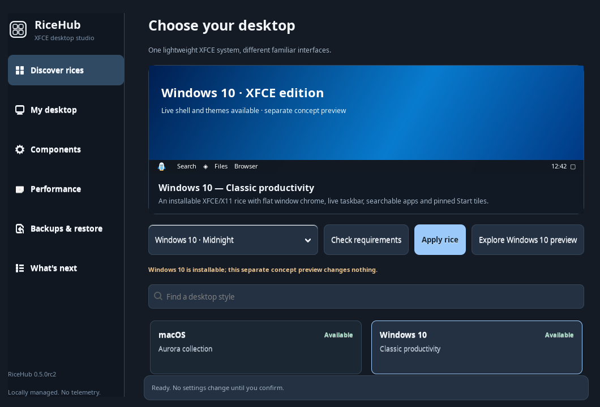

*Actual GTK3 RiceHub window in virtual X11. Windows 10 can now be checked and applied, while its older concept dialog remains available separately.*

### Windows 7: original Aero for Linux

| Complete desktop and Aero taskbar | Start menu and installed programs |
| --- | --- |
| 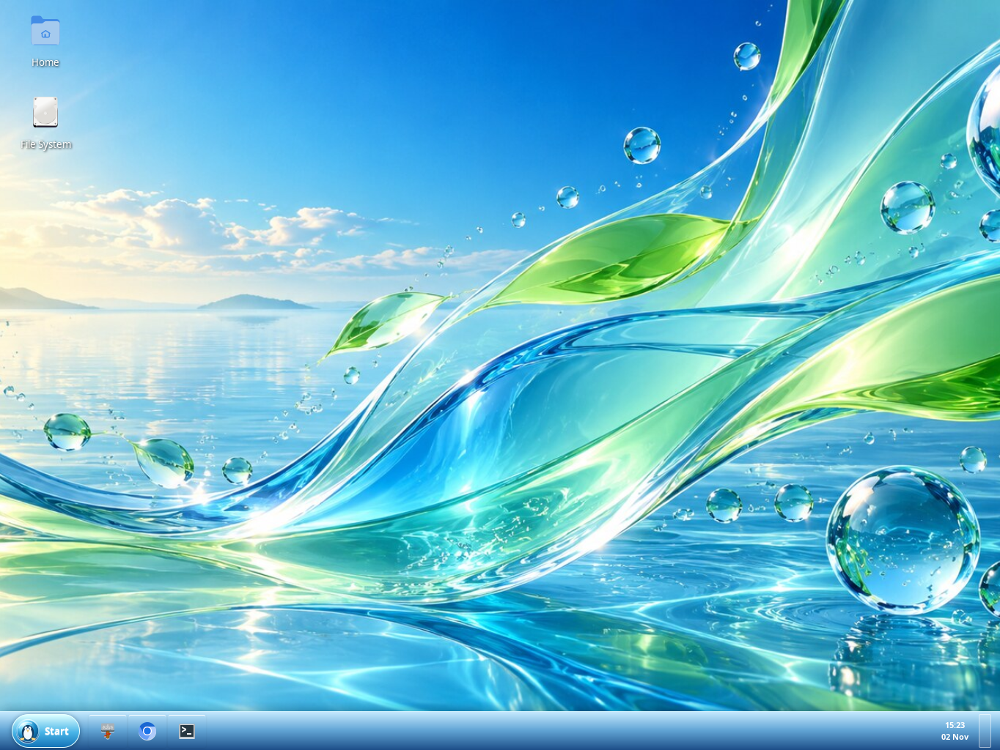 | 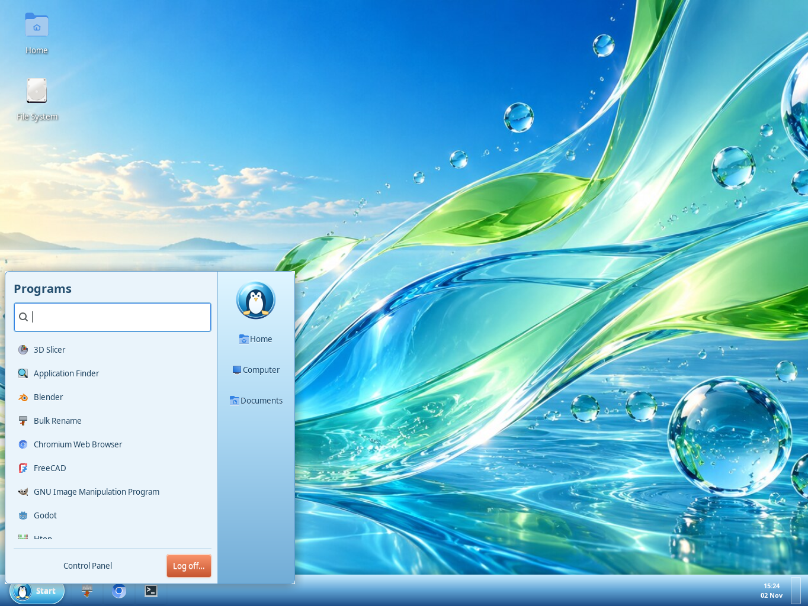 |
| Thunar and original XFWM4 window decoration | Search in the Start menu |
| 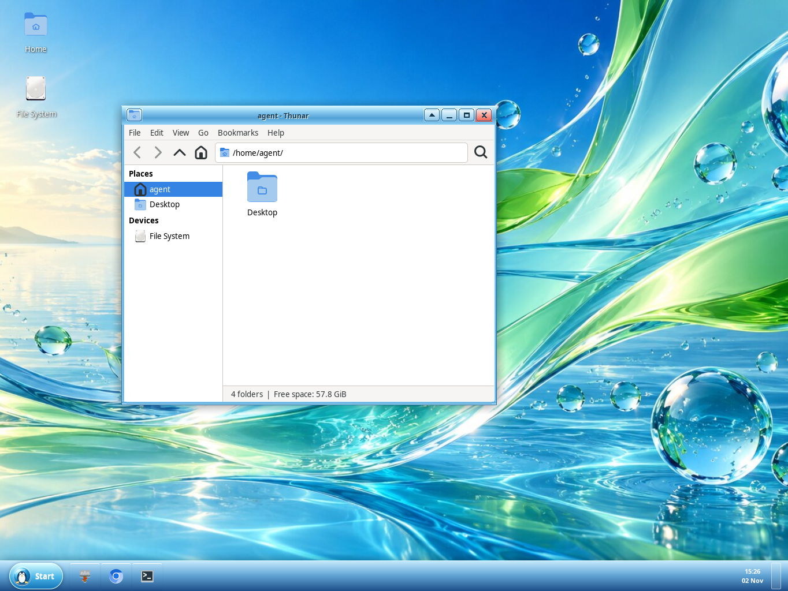 | 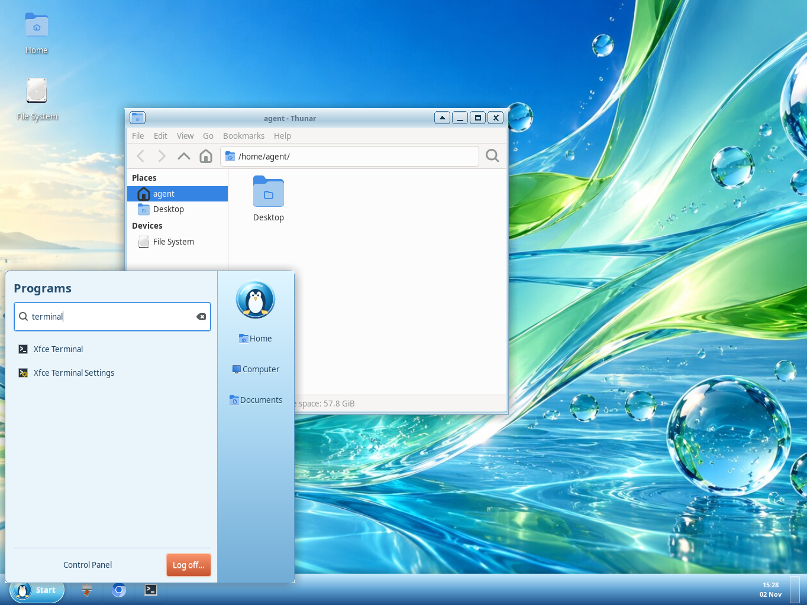 |

*Real RiceHub 0.3 RC2 captures from a temporary XFCE/X11 session, not painted mockups or a physical Linux Mint acceptance test. The optional Wnck window list and StatusNotifier icons were unavailable in this session, so they are not shown. See the [Windows 7 gallery and coverage notes](WINDOWS7.md#screenshots--coverage).*

The two included [Aero Meadow](assets/wallpapers/aero-meadow.jpg) and [Aero Cascade](assets/wallpapers/aero-cascade.jpg) wallpapers were created for this project. Windows 7 also includes:

- A unique glossy **Aero Penguin** Start symbol — Linux identity, no Windows logo.
- Original RiceHub-Aero **GTK3, XFWM4 window-border and icon themes**, plus matching Thunar styling.
- A lightweight bottom taskbar with pinned apps, a live clock, a searchable Start menu and **live running-window buttons**. Open windows can be activated, minimized and restored; extra windows appear in a compact overflow menu. The app catalog uses Gio and the optional window list uses Wnck signals, without process polling.
- A matching glass Plank theme. While Aero is selected, Plank moves to an autohiding left edge so it doesn't overlap the taskbar; the previous dock preferences are restorable.
- A user-local login autostart entry, created only when you apply an Aero rice and removed when returning to macOS.

The Aero shell now includes **experimental StatusNotifier tray icons**, **Show Desktop**, user-pinnable taskbar programs (persistent across logins), an adaptive Start menu, accessible keyboard search, native network/sound shortcuts and an opt-in translucent gradient. It can reserve the X11 bottom workarea for maximized windows. **Legacy XEmbed icons and true compositor blur are not supported.** The Start button and Escape close the menu; focus dismissal remains best-effort under X11. Existing MacBar or XFCE Panel instances are never forcibly terminated.

**[Explore every Windows 7 component and visual asset](WINDOWS7.md)** — complete file-by-file inventory, installation, customizations, verification, genuine screenshot gallery and open limitations. RiceHub contains no copied Microsoft visual assets.

For live window buttons on Linux Mint XFCE, install the optional Wnck3 introspection package:

```bash
sudo apt install gir1.2-wnck-3.0
```

Without Wnck, the Aero taskbar still opens with pinned apps, Start search and a clock. RiceHub does not install packages for you. Live-window tracking requires an X11 session, not Wayland.

### Windows 10: installable XFCE/X11 rice

| Live Start menu, installed apps and blue pinned tiles | Action Center with XFCE settings shortcuts |
| --- | --- |
| 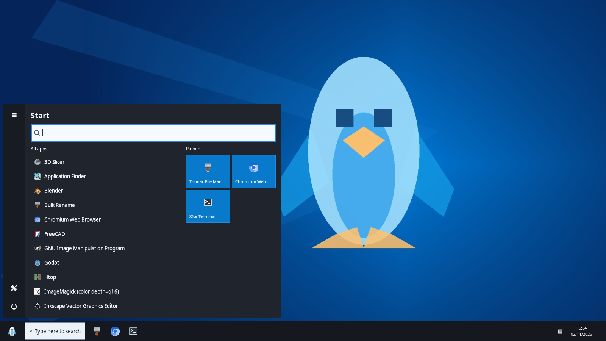 | 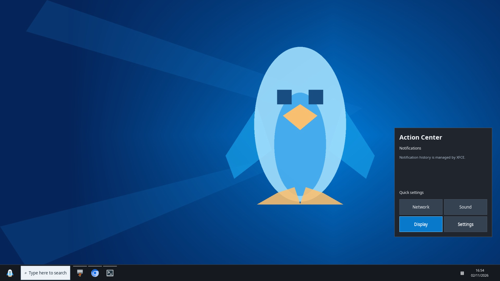 |

*Actual running RiceHub Ten GTK shell windows and original wallpaper in an isolated virtual X11 desktop fixture. Installed applications are listed from Gio, not invented examples. No physical Linux Mint system was changed. System tray and real window integration require the corresponding desktop services.*

Select **Windows 10** in RiceHub, choose **Midnight** or **Blue**, use **Check requirements**, then **Apply rice**. This installs original dark/light themes, Linux-penguin icons and wallpaper, starts the shared live taskbar, and records a reversible snapshot. Application search and pinned tiles launch your real installed apps; Wnck tracks real windows, the SNI tray accepts supported icons, and Action Center opens existing XFCE settings tools. The separate **Explore Windows 10 preview** dialog is retained as a harmless early concept. See [the implementation, screenshots and acceptance checklist](WINDOWS10.md).

### macOS rice with Plank

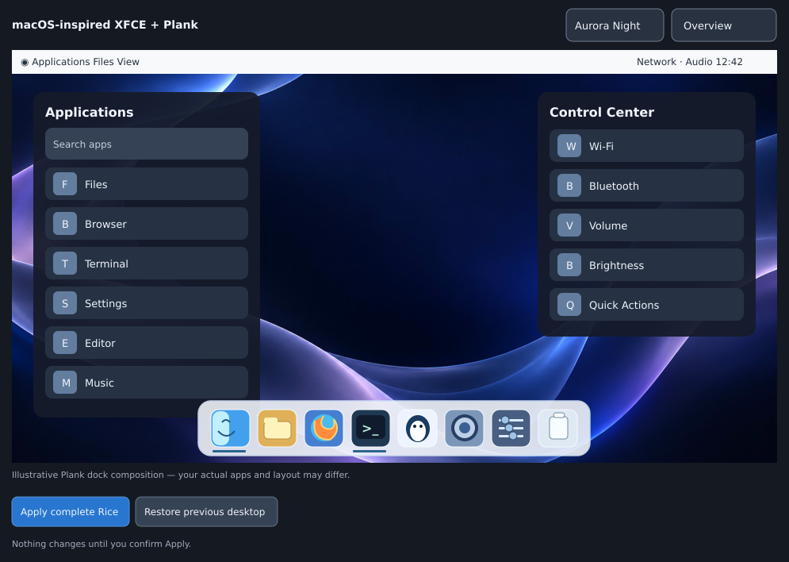

*Illustrative complete-desktop composition, including a **Plank-style** dock. This is not a photograph of a live Plank installation; the virtual test session doesn't have Plank. For real GTK screenshots, see [MacMenu](components/macmenu/screenshots/), [Control Center](components/control-center/screenshots/) and [MacBar](components/macbar/screenshots/).*

### Four new installable desktop rices

**Windows XP Luna** brings a green Start button and blue taskbar; **Windows 98 / 2000 Classic** uses compact gray controls, a narrow retro Start menu and teal wallpaper; **ChromeOS** provides a light shelf, centered application drawer and quick settings; and **Y2K / Frutiger Aero** pairs an aqua bar with an original eco-futurist landscape. All four use real installed applications, live Wnck window buttons (when available), Gio launchers, editable taskbar pins, keyboard toggles, and the same safe plan/apply/restore engine as Aero and Ten.

| Windows XP Luna | Windows 98 / 2000 Classic |
| --- | --- |
| 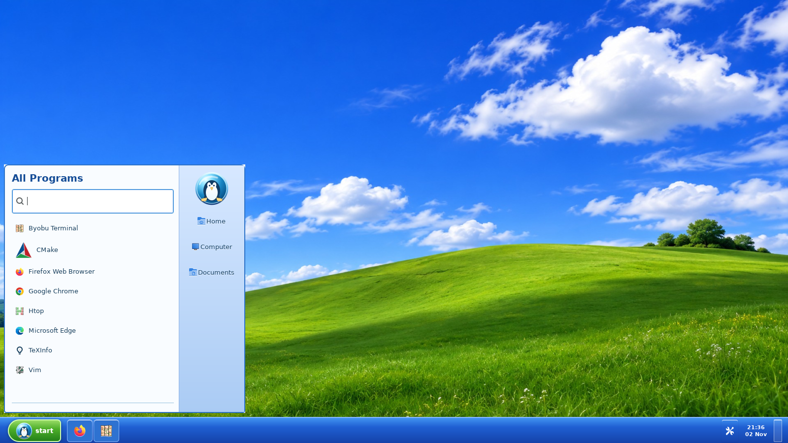 | 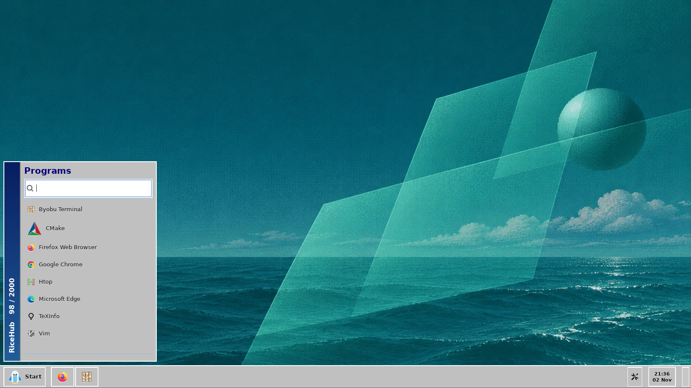 |
| [Control Panel screenshot](screenshots/ricehub-winxp-controls-0.6.0.png) | [Control Panel screenshot](screenshots/ricehub-winclassic-controls-0.6.0.png) |

| ChromeOS Pastel Shelf | Y2K / Frutiger Aero |
| --- | --- |
| 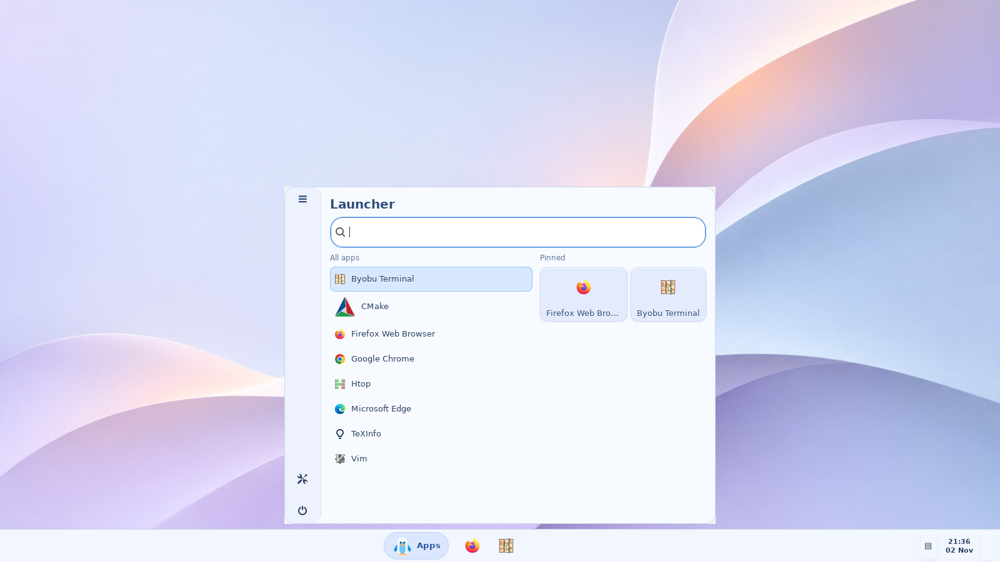 | 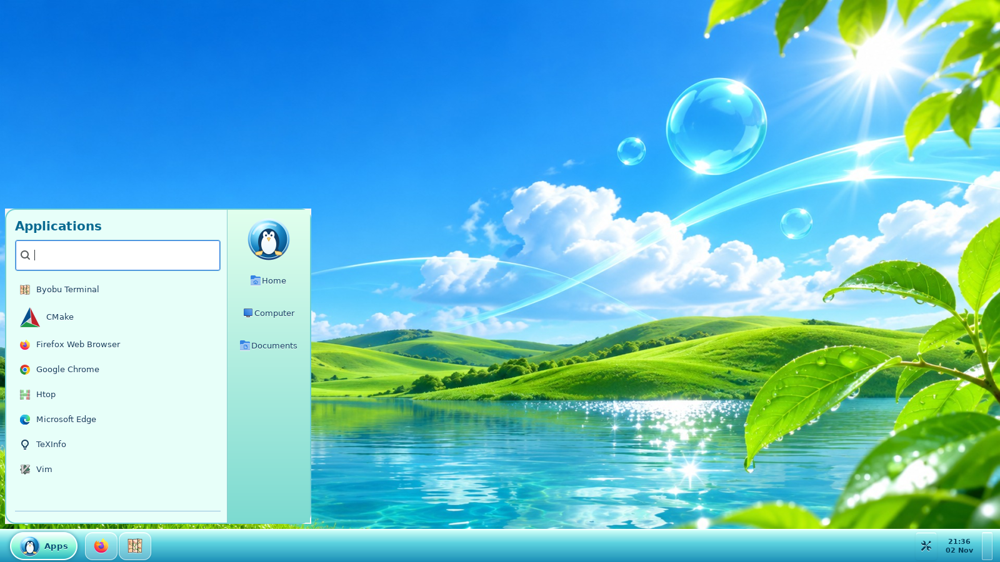 |
| [Quick Settings screenshot](screenshots/ricehub-chromeos-controls-0.6.0.png) | [Quick Settings screenshot](screenshots/ricehub-frutiger-controls-0.6.0.png) |

*These are actual running GTK3 components captured in isolated virtual X11 on GitHub Actions, not static mockups or screenshots from the author's ThinkPad. Native system tray icons and Wnck window switching depend on desktop services running in the target session.*

Each family retains an optional interactive GTK3 **preview**. Preview apps and the sample file manager are illustrative; selecting **Apply rice** instead starts the actual desktop components. See the [implementation roadmap and hardware gates](CONCEPTS.md).


## What's in RiceHub?

The hub itself is written with Python and GTK3. It opens when you need it and doesn't install a web stack, new resident daemon or telemetry service.

| Hub area | Available now |
| --- | --- |
| **Discover** | Browse and search OS-inspired rices, filter by availability, preview wallpaper palettes and check requirements before applying. |
| **My Desktop** | See detected GTK, window, icon, cursor, font and Plank settings without changing them. |
| **Components** | Toggle MacMenu and Control Center, start MacBar and Plank, inspect or explicitly repair bundled apps. |
| **Performance** | Choose Light, Balanced or Visual settings; measure process memory and CPU on demand. |
| **Backups & Restore** | Find private full-rice restore points and recover the last supported state, while respecting later personal changes when possible. |
| **What's Next** | See outstanding reliability, compatibility and hardware-acceptance milestones. |

### Supported desktop styles

| Family | Styles | Status |
| --- | --- | --- |
| macOS-inspired | Aurora Night, Aurora Day, Classic Aqua | **Installable** |
| Windows 10-inspired | Windows 10 Midnight, Windows 10 Blue | **Installable** |
| Windows 7-inspired | Aero Meadow, Aero Cascade | **Installable** |
| Windows XP Luna | XP Luna (blue/green) | **Installable — 0.6** |
| Windows 98 / 2000 | Classic (gray/teal) | **Installable — 0.6** |
| ChromeOS-inspired | Pastel Shelf | **Installable — 0.6** |
| Y2K / Frutiger Aero | Aqua Future | **Installable — 0.6** |

The working macOS rice brings together [MacMenu](components/macmenu/), [Control Center](components/control-center/), [MacBar](components/macbar/), Plank, Thunar, WhiteSur-based GTK/window themes, icons and Aurora wallpapers. All three bundled apps keep their own tested installers. Plank remains a system package and your pinned dock items are preserved.

RiceHub preserves an older or customized Plank theme when its name collides with a bundled theme. It selects a content-versioned copy, trying the next free numbered name if that copy was also customized. No existing dock theme is overwritten. Switching between all seven families retains dock launchers and reversible dock settings; the inactive RiceHub taskbar is asked to quit before the next one starts. An independently launched MacBar or XFCE Panel is never killed by an unverified PID.

## Get started

Tested primarily with Linux Mint XFCE / X11. Other XFCE/X11 setups may work, but don't assume every theme or system service is installed.

```bash
sudo apt install python3-gi gir1.2-gtk-3.0 gir1.2-wnck-3.0
git clone https://github.com/CopyPasteUser/RiceHub.git
cd RiceHub
bash install.sh --dry-run
bash install.sh
ricehub
```

The previous `macos-xfce-rice` GitHub address redirects to RiceHub, so old bookmarks and install commands should continue to work. No `sudo` for `install.sh`. The installer does **not** apply a full rice, remove the XFCE panel, change your icons, or silently install missing themes. It installs user-local tools and keeps existing component settings.

If you want Plank and don't have it yet, install it separately using your distribution's package manager. The full macOS style also needs compatible WhiteSur, Bibata and Inter assets; the preflight check tells you what's missing.

**Already installed?** Update from any directory:

```bash
bash -c 'set -e; d="$(mktemp -d)"; git clone -q --depth 1 https://github.com/CopyPasteUser/RiceHub.git "$d/ricehub"; bash "$d/ricehub/install.sh"'
```

### Everyday commands

```bash
ricehub                       # Open the new desktop rice hub
macrice hub                   # Same application, legacy CLI
macrice status                # Check installed components and appearance
macrice rice plan night       # Inspect changes before applying anything
macrice rice apply night      # Apply Aurora Night with a recovery snapshot
macrice rice apply day        # Change to Aurora Day
macrice rice plan aero-meadow  # Check the Windows 7-style Aero preset
macrice rice apply aero-meadow # Apply original Aero styling (with rollback snapshot)
macrice rice apply aero-cascade # Switch to the glassier Aero palette
macrice aero-shell             # Toggle the real Aero Start menu / taskbar
macrice aero-shell --quit      # Stop the Aero shell
macrice rice plan ten-dark     # Check original Windows 10 dark assets and desktop requirements
macrice rice apply ten-dark    # Install Windows 10 Midnight, autostart and recovery point
macrice rice apply ten-light   # Switch to Windows 10 Blue (light XFWM/GTK)
macrice windows10-shell       # Start/toggle the real Windows 10 taskbar
macrice windows10-shell --quit # Stop only the RiceHub Windows 10 shell
macrice rice apply winxp      # Original XP Luna-like desktop
macrice rice apply winclassic # Original 98/2000 classic desktop
macrice rice apply chromeos   # Pastel shelf and real app drawer
macrice rice apply frutiger   # Aqua glass-like desktop
macrice winxp-shell --quit    # Stop only the XP taskbar (other families: <key>-shell)
macrice rice restore          # Restore the latest active rice snapshot
macrice performance report    # One-off memory / CPU sample
macrice gui                   # Original MacRice manager (still supported)
macrice session-sync          # Reconcile the selected rice, keyboard shortcuts and panel
macrice session-menu          # Toggle the active rice's Start / application menu
macrice session-control       # Toggle the active rice's control panel / action center
macrice session-keys-restore  # Restore the previous XFCE Super and Right Ctrl bindings
```

**Rice-aware keyboard controls:** On each desktop switch RiceHub updates the
shortcuts to invoke that rice's own toggle directly. macOS uses its lightweight
MacMenu/Control Center launchers; Windows 7/10 use the user-local `ricehub-toggle`
wrapper to send a GTK application action over D-Bus, falling back to the normal
shell startup command if that taskbar is not yet running. No Python theme lookup
or additional long-lived shortcut daemon is needed for each keystroke.

In an active RiceHub session, `Super_L` opens
the macOS application menu or the Windows Start menu. `Control_R` opens the
macOS Control Center, Windows 10 Action Center or the Aero-styled Windows 7
Control Panel. Press the same shortcut again to hide the component. Windows
taskbars also provide clickable toggles for these overlays. These are
user-local XFCE shortcuts; their prior assignments
are saved under `~/.local/share/macrice-state/session-shortcuts.json` before
being changed. Older `macrice session-menu/session-control` shortcut bindings are
upgraded safely, and manually edited shortcuts are not overwritten on later syncs.
The stock XFCE panel is asked to quit only *after* RiceHub has launched the
replacement components without reporting an immediate error. The macOS MacBar
launcher is resolved from the installed user-local bin directory, even when
XFCE starts RiceHub without that directory in `PATH`. The stock panel can always
be reopened with `xfce4-panel`.

When diagnosing a taskbar that exits after switching, see
`~/.local/state/ricehub/aero-shell.log` or
`~/.local/state/ricehub/ten-shell.log`; these private logs replace the old
discarded GTK stderr output. No background polling service is installed.

For your XFCE shortcuts, use `macmenu --toggle` and `macos-control-center-toggle`. The existing fast resident toggle behavior is unchanged.

## Safe by default

- **No surprise restyling.** Installing and opening RiceHub do not modify your desktop appearance. A full rice requires a successful preflight and your confirmation.
- **Recoverable changes.** Desktop snapshots live outside the replaceable app bundle, under `~/.local/share/macrice-state/`.
- **Controlled handoff.** Installation alone does not alter XFCE Panel. Activating an installed RiceHub desktop replaces the running stock panel non-destructively; Plank launchers and layout are not overwritten.
- **No extra background monitor.** The hub runs on demand. CPU/memory sampling happens only when you request it.
- **Honest previews.** Windows 7 and Windows 10 offer installable release-candidate rices plus optional non-installing concept dialogs. Some graphical effects depend on your existing X11 compositor.

## Where this is going

Version `0.6.0` expands real installation and switching to all seven families while keeping the original read-only concept dialogs. The next reliability milestone is physical Mint XFCE acceptance: rapid switching, login persistence, crash resilience, multi-monitor placement and rollback. See the [0.6.0 changelog](CHANGELOG.md), [new-family acceptance plan](CONCEPTS.md), [RiceHub product roadmap](RICEHUB.md) and [MacRice engine roadmap](ROADMAP.md). The project explicitly does **not** plan Windows 11 or Liquid Glass presets.

The existing MacMenu, Control Center and MacBar repositories have not been deleted. Their code stays independently testable while RiceHub becomes the main home for complete rices.

## Built in the open

RiceHub is MIT-licensed, community-friendly, and a little bit experimental. Issues, bug reports and real XFCE screenshots are welcome — see [Contributing](CONTRIBUTING.md) and [Security](SECURITY.md).

**Vibe-coded, human-directed and AI-assisted.** ChatGPT and OpenAI Codex helped with design and engineering; see [Contributors](CONTRIBUTORS.md) for credits and notes about original assets. This project is not affiliated with Apple or Microsoft and does not distribute their proprietary themes or logos.

*Inspired by familiar desktops. Built for Linux.*
