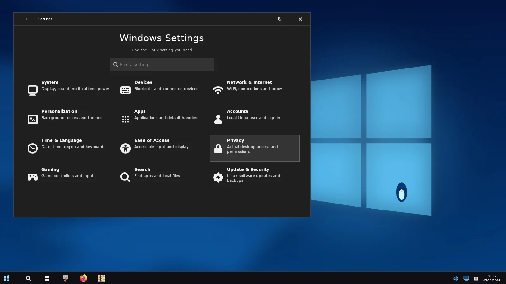

<div align="center">


# RiceBowl

**Seven desktop styles. One Linux desktop.**

Give XFCE a completely different personality—from Windows XP nostalgia to Frutiger Aero—without replacing your operating system.

[Explore styles](#desktop-styles) · [Get started](#get-started) · [All screenshots](screenshots/current/README.md)

</div>

<p align="center">
  <a href="screenshots/current/aero-start.webp"></a>
  <a href="screenshots/current/frutiger-start.webp"></a>
  <a href="screenshots/current/winxp-start.webp"></a>
  <a href="screenshots/current/windows10-settings-home.webp"></a>
</p>

<div align="center"><sub>Actual GTK/X11 captures from the <a href="https://github.com/CopyPasteUser/RiceBowl/actions/runs/42003767466">5 November 2026 CI run</a> · <a href="screenshots/current/README.md">See all 34 screenshots</a></sub></div>

## Desktop styles

[macOS Aurora](components/macmenu/README.md) · [Windows 7 Aero](WIN7_AERO_ROADMAP.md) · [Windows 10](WINDOWS10_ROADMAP.md) · [Windows XP Luna](XP_LUNA_ROADMAP.md) · [Windows 98](CLASSIC_98_ROADMAP.md) · [ChromeOS](CHROMEOS_ROADMAP.md) · [Frutiger Aero](FRUTIGER_AERO_ROADMAP.md)

Each style brings its own taskbar, launcher, menus, icons, wallpaper and system controls. RiceBowl uses native GTK and real Linux services—**no Electron or fake device toggles**.

## Get started

For **Linux Mint XFCE or another XFCE/X11 desktop**:

```bash
sudo apt install -y git python3-gi python3-cairo python3-gi-cairo gir1.2-gtk-3.0 gir1.2-wnck-3.0
git clone https://github.com/CopyPasteUser/RiceBowl.git "$HOME/RiceBowl"
cd "$HOME/RiceBowl"
bash install.sh --dry-run
bash install.sh
"$HOME/.local/bin/ricebowl"
```

Pick a style in the Hub. **Nothing is applied automatically**: RiceBowl checks requirements, asks for confirmation and saves a recovery snapshot before switching.

**Updating:** Use **Check for updates** in the Hub. To return to your previous desktop settings, run `macrice rice restore`.

## Project status

<strong>Development preview</strong> · Latest tagged build: [v0.9.1](https://github.com/CopyPasteUser/RiceBowl/releases/tag/v0.9.1). Newer changes are on `main`; 1.0 hardware acceptance on real XFCE systems is still pending.

[Roadmap](ROADMAP.md) · [Known issues & hardware checks](ACCEPTANCE_1_0.md) · [Changelog](CHANGELOG.md) · [Contributing](CONTRIBUTING.md) · [License](LICENSE)

<sub>RiceBowl uses original artwork and is not affiliated with Apple, Google or Microsoft. Thunar remains available; [riceExplorer](https://github.com/CopyPasteUser/riceExplorer) is a separate work in progress.</sub>
