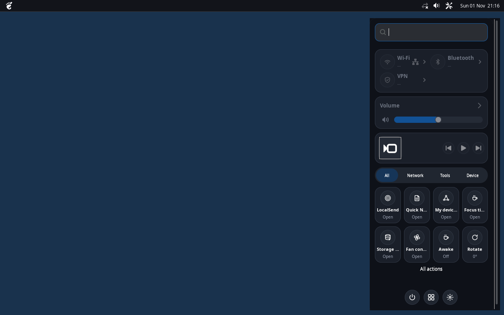
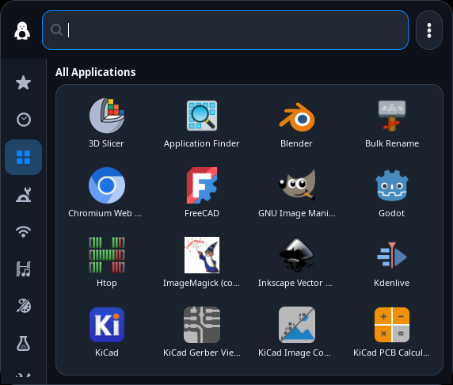
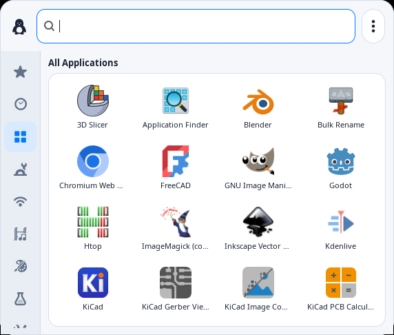
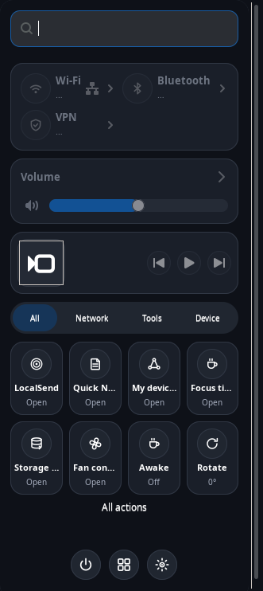
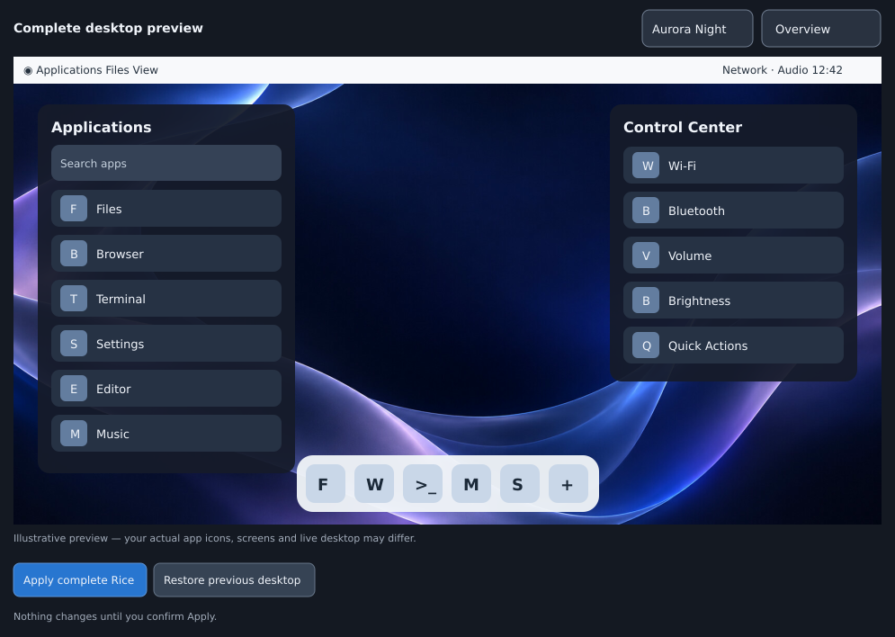

# RiceHub

### Your desktop, your rules. A home for XFCE rices.

RiceHub is a small, native Linux app for turning an ordinary XFCE desktop into something personal. It started with a love of macOS's clean interface and XFCE's speed. The goal is bigger now: one friendly place to discover, preview, apply and eventually share complete desktop styles — without swapping out your desktop environment.

**The macOS-inspired rice works today.** Windows 7, 10 and 11 are in the gallery as clearly marked **Coming soon** entries. RiceHub is an early `0.1 RC1` preview, not a finished multi-OS theme engine.



*Real GTK3/X11 capture of MacBar and Control Center in the current macOS rice. Hardware-dependent indicators are limited in the virtual test session.*

## A quick look

| MacMenu — Midnight | MacMenu — Light |
| :---: | :---: |
|  |  |

| Control Center — Dark | MacBar |
| :---: | :---: |
|  |  |

*These are actual GTK app captures. Below is an **illustrative** complete-desktop preview from the existing preview tool, not a photograph of an installed desktop. A real screenshot of the new RiceHub window is still planned.*



## What's in RiceHub?

The hub itself is written with Python and GTK3. It opens when you need it and doesn't install a web stack, new resident daemon or telemetry service.

| Hub area | Available in 0.1 |
| --- | --- |
| **Discover** | Browse and search OS-inspired rices, filter by availability, preview wallpaper palettes and check requirements before applying. |
| **My Desktop** | See detected GTK, window, icon, cursor, font and Plank settings without changing them. |
| **Components** | Toggle MacMenu and Control Center, start MacBar and Plank, inspect or explicitly repair bundled apps. |
| **Performance** | Choose Light, Balanced or Visual settings; measure process memory and CPU on demand. |
| **Backups & Restore** | Find private full-rice restore points and recover the last supported state, while respecting later personal changes when possible. |
| **What's Next** | Explore planned Windows styles and see what's actually still being built. |

### Supported desktop styles

| Family | Styles | Status |
| --- | --- | --- |
| macOS-inspired | Aurora Night, Aurora Day, Liquid Glass Night, Liquid Glass Day, Classic Aqua | **Available (preview)** |
| Windows 10-inspired | Classic productivity desktop | **Coming soon** |
| Windows 11-inspired | Centered taskbar and launcher | **Coming soon** |
| Windows 7-inspired | Classic Aero-style desktop | **Coming soon** |

The working macOS rice brings together [MacMenu](components/macmenu/), [Control Center](components/control-center/), [MacBar](components/macbar/), Plank, Thunar, WhiteSur-based GTK/window themes, icons and Aurora wallpapers. All three bundled apps keep their own tested installers. Plank remains a system package and your pinned dock items are preserved.

## Get started

Tested primarily with Linux Mint XFCE / X11. Other XFCE/X11 setups may work, but don't assume every theme or system service is installed.

```bash
sudo apt install python3-gi gir1.2-gtk-3.0
git clone https://github.com/CopyPasteUser/macos-xfce-rice.git
cd macos-xfce-rice
bash install.sh --dry-run
bash install.sh
ricehub
```

The old repository URL remains the working download address until the GitHub repository itself is renamed. No `sudo` for `install.sh`. The installer does **not** apply a full rice, remove the XFCE panel, change your icons, or silently install missing themes. It installs user-local tools and keeps existing component settings.

If you want Plank and don't have it yet, install it separately using your distribution's package manager. The full macOS style also needs compatible WhiteSur, Bibata and Inter assets; the preflight check tells you what's missing.

**Already installed?** Update from any directory:

```bash
bash -c 'set -e; d="$(mktemp -d)"; git clone -q --depth 1 https://github.com/CopyPasteUser/macos-xfce-rice.git "$d/ricehub"; bash "$d/ricehub/install.sh"'
```

### Everyday commands

```bash
ricehub                       # Open the new desktop rice hub
macrice hub                   # Same application, legacy CLI
macrice status                # Check installed components and appearance
macrice rice plan night       # Inspect changes before applying anything
macrice rice apply night      # Apply Aurora Night with a recovery snapshot
macrice rice apply day        # Change to Aurora Day
macrice rice apply glass-day  # Try Liquid Glass Day
macrice rice restore          # Restore the latest active rice snapshot
macrice performance report    # One-off memory / CPU sample
macrice gui                   # Original MacRice manager (still supported)
```

For your XFCE shortcuts, use `macmenu --toggle` and `macos-control-center-toggle`. The existing fast resident toggle behavior is unchanged.

## Safe by default

- **No surprise restyling.** Installing and opening RiceHub do not modify your desktop appearance. A full rice requires a successful preflight and your confirmation.
- **Recoverable changes.** Desktop snapshots live outside the replaceable app bundle, under `~/.local/share/macrice-state/`.
- **No takeover.** The XFCE panel is not replaced automatically. Plank launchers and layout are not overwritten during installation.
- **No extra background monitor.** The hub runs on demand. CPU/memory sampling happens only when you request it.
- **Honest previews.** Future Windows rices have no fake Apply button. Some graphical effects depend on your existing X11 compositor.

## Where this is going

The first goal is a dependable macOS rice and a useful central manager. Next come better compatibility checks and recovery, then working Windows 10, 11 and 7 integrations using the **same** safe apply/restore engine. See the [RiceHub product roadmap](RICEHUB.md) and [MacRice engine roadmap](ROADMAP.md).

The existing MacMenu, Control Center and MacBar repositories have not been deleted. Their code stays independently testable while RiceHub becomes the main home for complete rices.

## Built in the open

RiceHub is MIT-licensed, community-friendly, and a little bit experimental. Issues, bug reports and real XFCE screenshots are welcome — see [Contributing](CONTRIBUTING.md) and [Security](SECURITY.md).

**Vibe-coded, human-directed and AI-assisted.** ChatGPT and OpenAI Codex helped with design and engineering; see [Contributors](CONTRIBUTORS.md) for credits and notes about original assets. This project is not affiliated with Apple or Microsoft and does not distribute their proprietary themes or logos.

*Inspired by familiar desktops. Built for Linux.*
