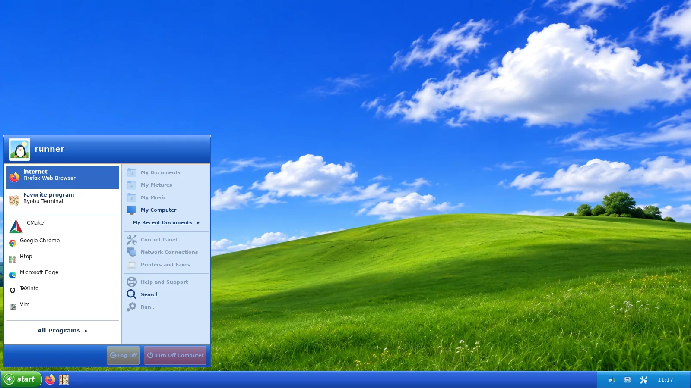
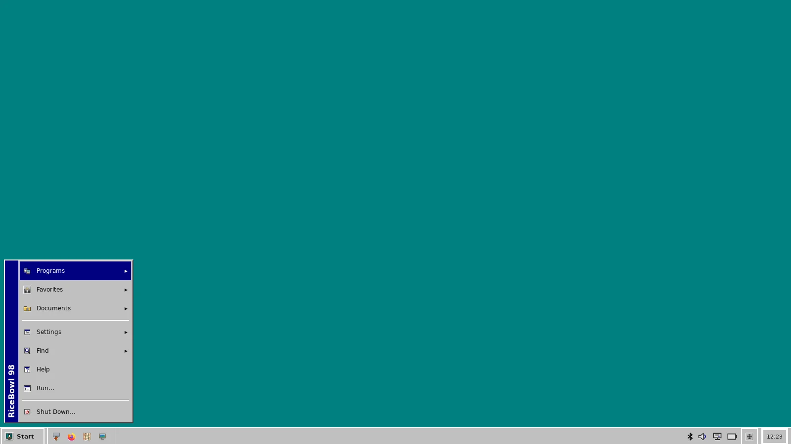
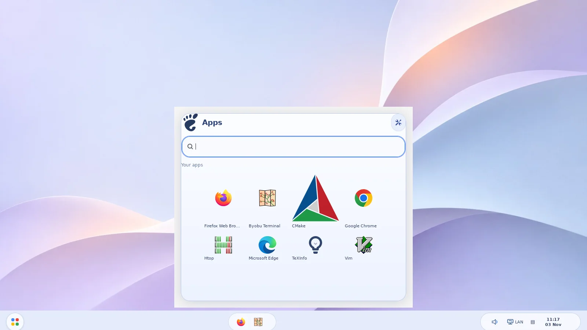
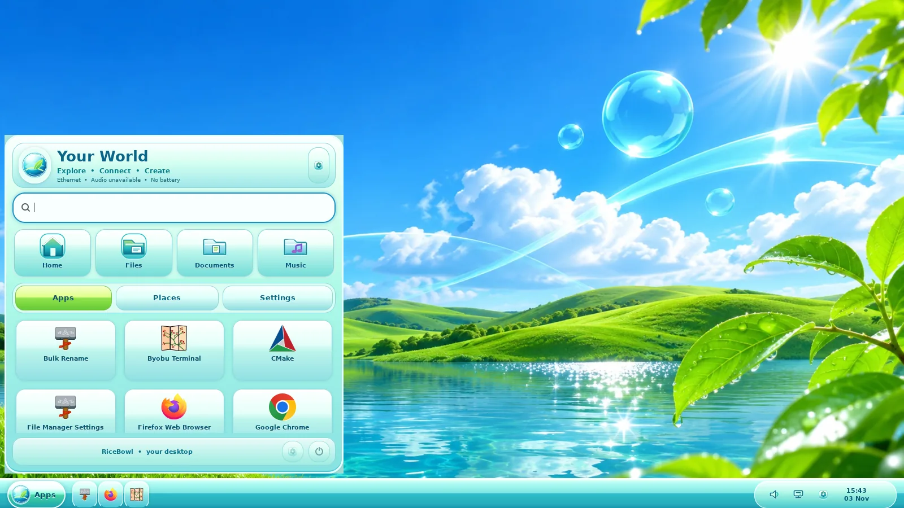

<div align="center">


# RiceBowl

**Seven desktop styles. One reversible XFCE session.**

Native Python/GTK3 desktop customization for Linux Mint XFCE and other **XFCE/X11** systems.

[Install](#install) · [Styles](#styles) · [Commands](#commands) · [Recovery](#recovery) · [Changelog](CHANGELOG.md)

</div>

RiceBowl changes the actual Linux desktop: GTK and XFWM4 themes, icons, wallpaper, taskbar, launcher and Thunar styling. Its menus launch installed applications, and system controls use real Linux backends. No Electron, telemetry or proprietary Windows/macOS/ChromeOS assets.

> **Version note:** `main` contains the latest improvements. The tagged [v0.9.1 release](https://github.com/CopyPasteUser/RiceBowl/releases/tag/v0.9.1) is older.

## Styles

| Style | Preset(s) | What changes |
| --- | --- | --- |
| **macOS · Aurora** | `night`, `day`, `aqua` | MacBar, MacMenu, Control Center; optional Plank dock |
| **[Windows 7 · Aero](WIN7_AERO_ROADMAP.md)** | `aero-meadow`, `aero-cascade` | Glass Superbar, two-column Start, previews, Jump Lists and Control Panel |
| **[Windows 10](WINDOWS10_ROADMAP.md)** | `ten-light`, `ten-dark` | Flat taskbar, pinned Start tiles and Action Center |
| **[Windows XP · Luna](XP_LUNA_ROADMAP.md)** | `winxp` | Blue/green taskbar, themed cascading Start menus and navigable Control Panel tasks |
| **[Windows 98 / 2000](CLASSIC_98_ROADMAP.md)** | `winclassic` | Teal desktop, beveled taskbar and cascading Start menus |
| **[ChromeOS](CHROMEOS_ROADMAP.md)** | `chromeos` | Material You shelf, searchable app launcher and Quick Settings |
| **[Frutiger Aero](FRUTIGER_AERO_ROADMAP.md)** | `frutiger` | Aqua World, live Places, three-level Control Center and device flyouts |

### Current screenshots

Captured from real GTK3 shells on virtual X11—not mockups.

| Windows 7 | Windows 10 |
| --- | --- |
|  |  |
| **Windows XP** | **Windows 98** |
|  |  |
| **ChromeOS** | **Frutiger Aero** |
|  |  |

[More screenshots: Control Panels and real Thunar windows](screenshots/current/)

## Install

Use an **XFCE session on X11**. Run the installer as your normal user; only the prerequisite packages need `sudo`.

```bash
sudo apt install -y git python3-gi python3-cairo python3-gi-cairo gir1.2-gtk-3.0 gir1.2-wnck-3.0
git clone https://github.com/CopyPasteUser/RiceBowl.git "$HOME/RiceBowl"
cd "$HOME/RiceBowl"
bash install.sh --dry-run
bash install.sh
"$HOME/.local/bin/ricebowl"
```

The installer adds user-local commands and assets. **It does not apply a style or shut down XFCE Panel.** The hub reports optional requirements before applying a rice.

### Update an existing installation

Run this from the directory where you cloned RiceBowl (the example assumes `~/RiceBowl`):

```bash
cd "$HOME/RiceBowl"
git pull --ff-only
bash install.sh --dry-run
bash install.sh
```

If `~/RiceBowl` does not exist, use the **Install** commands to clone it first. Do not run `install.sh` with `sudo`.

## Commands

```bash
ricebowl                       # Open the graphical hub
macrice status                 # Inspect current setup
macrice rice plan aero-meadow  # Read-only check before applying
macrice rice apply aero-meadow # Switch with recovery snapshot
macrice rice apply frutiger    # Switch to another style
macrice rice restore           # Restore previous desktop settings
```

The active rice uses **Super** for its app menu and **Right Ctrl** for Control Panel/Quick Settings. RiceBowl backs up previous shortcut bindings and coordinates its taskbar with XFCE Panel and Plank.

## Recovery

```bash
macrice rice restore          # Undo the most recent applicable rice
macrice session-sync          # Reconcile the active rice after login
macrice session-keys-restore  # Restore previous Super/Right Ctrl shortcuts
```

Customized theme assets are preserved rather than silently overwritten. If a style fails its asset preflight, inspect the reported conflict; `macrice rice repair-assets STYLE` is an **explicit, backed-up replacement** of that style's managed assets—not a routine update command.

## Scope and limitations

- **XFCE/X11 only.** Wayland and full Windows-style DWM blur are not supported.
- **Thunar stays Thunar.** RiceBowl themes its GTK controls, navigation, icons and window decoration; it cannot reproduce every Windows Explorer layout or feature.
- **Physical-hardware validation is ongoing.** Virtual-X11 tests cover the shells and screenshots; multi-monitor, login/resume and customized Plank autostart still need real Mint XFCE acceptance testing.
- Original themes and artwork are included; this project is not affiliated with Apple, Google or Microsoft.

See the [roadmap](ROADMAP.md), [CI checks](https://github.com/CopyPasteUser/RiceBowl/actions) and [contributing guide](CONTRIBUTING.md). Licensed under [MIT](LICENSE).
