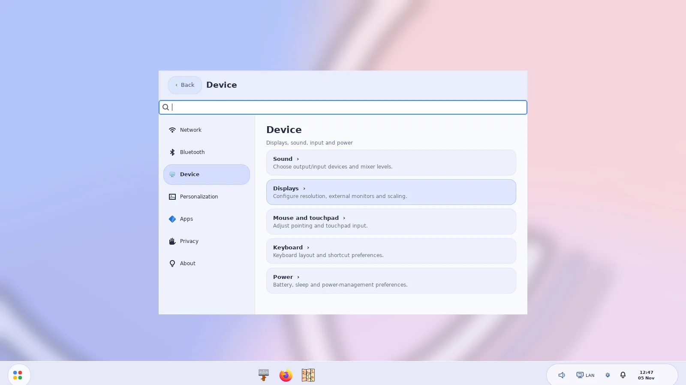
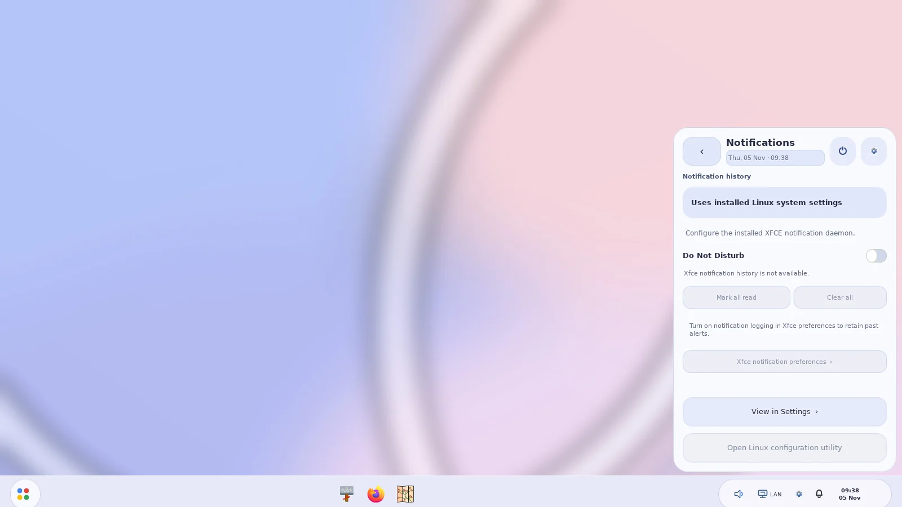
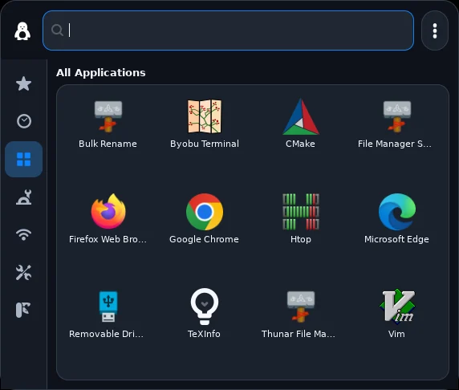

<div align="center">


# RiceBowl

**Seven desktop styles. One reversible XFCE session.**

Native Python/GTK3 desktop customization for Linux Mint XFCE and other **XFCE/X11** systems.

[Install](#install) · [Styles](#styles) · [Commands](#commands) · [Recovery](#recovery) · [Changelog](CHANGELOG.md)

</div>

RiceBowl changes the actual Linux desktop: GTK and XFWM4 themes, icons, wallpaper, taskbar, launcher and Thunar styling. Its menus launch installed applications, and system controls use real Linux backends. No Electron, telemetry or proprietary Windows/macOS/ChromeOS assets.

> **Version note:** `main` contains the latest improvements. The tagged [v0.9.1 release](https://github.com/CopyPasteUser/RiceBowl/releases/tag/v0.9.1) is older.

## Styles

| Style | Preset(s) | What changes |
| --- | --- | --- |
| **macOS · Aurora** | `night`, `day`, `aqua` | MacBar, MacMenu, Control Center; optional Plank dock |
| **[Windows 7 · Aero](WIN7_AERO_ROADMAP.md)** | `aero-meadow`, `aero-cascade` | Glass Superbar with attention states and window tiling, previews, Aero flyouts, desktop shortcuts and Control Panel |
| **[Windows 10](WINDOWS10_ROADMAP.md)** | `ten-light`, `ten-dark` | Flat taskbar, pinned Start tiles and Action Center |
| **[Windows XP · Luna](XP_LUNA_ROADMAP.md)** | `winxp` | XP Control Panel, configurable taskbar and Start, native Help and Support, device flyouts and optional desktop icons |
| **[Windows 98 SE (classic)](CLASSIC_98_ROADMAP.md)** | `winclassic` | Teal desktop, real Start descendants, Win98 Control Panel, Quick Launch/taskbar preferences and live tray menus |
| **[ChromeOS](CHROMEOS_ROADMAP.md)** | `chromeos` | Material You shelf, app launcher, Quick Settings, XFCE notification history, local calendar and searchable Settings |
| **[Frutiger Aero](FRUTIGER_AERO_ROADMAP.md)** | `frutiger` | Aqua World launcher with working Back navigation, native Wi-Fi/audio/Bluetooth/brightness/power controls, live Places and device flyouts |

Windows 98 **Control Panel → System** now opens a native, read-only **System Properties** viewer with General, Device Manager and Performance tabs showing actual Linux CPU, memory, network, disks and uptime. Refresh is manual, and nothing is installed or reconfigured.

Windows 98 **Help** now opens an offline Contents/Index/Search viewer with functional Back/Forward/Home navigation instead of a static topic list. Its pages explain the actual Linux controls and feature limitations.

Windows 98 **Find → Files or Folders** now supports file/folder type, extension, modification-date, size and hidden-file filters, plus bounded UTF-8 content search. Search runs in a cancellable worker with hard scan/result budgets; it never modifies files.

The latest Classic Run dialog supports a private session-only recent-command list, Clear history and inline error feedback. No shell commands are interpreted implicitly. Windows 98 Programs flyouts also support right-click Open / Quick Launch pin actions where desktop applications have valid IDs.

The Windows 98 rice is still a work in progress: classic Taskbar Properties now saves real clock/Quick Launch options; auto-hide, taskbar relocation and Explorer internals remain open. GTK/X11 CI is in place, and physical Mint acceptance is still required. A separate historically authentic Windows 2000 preset is planned. [Detailed checklist](CLASSIC_98_ROADMAP.md).

Windows 7 now has dedicated audio, Wi-Fi, power, Bluetooth and calendar
flyouts, a genuine hidden-application-icon chevron, opt-in desktop shortcuts
(Computer/Documents/Network/Recycle Bin, via blank-Superbar right-click),
per-app notification-icon preferences and multi-view Control Panel navigation.
Running apps now indicate real X11 requests for attention; their right-click
menus can tile individual windows left/right, maximize and restore their
original position using the monitor's available workarea.
Right-click empty Superbar space for real Cascade/Stacked/Side-by-side window
layouts, Undo window arrangement and an installed Linux Task Manager.
Pinned Windows 7 launcher icons can now be reordered using drag and drop or
keyboard-accessible **Move pin left/right** Jump List actions; each change is
persisted in the existing reversible Aero pin configuration.
Configure visible icons from the chevron or blank-Superbar context menu. Installed
[RiceExplorer](https://github.com/CopyPasteUser/riceExplorer) appears as an
optional Windows 7 preview in Start; Thunar remains the default while file
operation and mount recovery are validated. The gallery below was refreshed
from a single passing native-X11 CI run on 4 November 2026, with genuine
Start, Control Panel and Thunar views for all six non-macOS desktop styles.
Edge-drag Snap, global shortcuts, Shake and real compositor blur are still open.

ChromeOS now has its own **Settings** app with seven navigable categories,
search, detail pages and real installed Linux tool handoffs. The bottom-right
Quick Settings panel has **Back/Escape** navigation instead of opening a
separate XFCE utility on the first click. Its Network, Bluetooth, Display and
Power detail pages reuse read-back-verified Linux controls for Wi-Fi, nearby
networks, adapter power, screen brightness, battery and supported performance
profiles; unsupported hardware remains clearly unavailable. The Linux service
adapters run off the UI thread. Clicking the ChromeOS **Shelf clock** opens a
native local monthly calendar with month navigation and a Today action; the
date in Quick Settings opens the same view. A separate Shelf bell opens the
**actual XFCE notification log**, grouped by application with real unread
state, dismissal, verified Do Not Disturb and a confirm-before-clear action.
It uses XFCE's installed daemon and does not intercept notifications;
unavailable or disabled history is explained rather than invented. Live
ChromeOS-style toast notifications, Google-only services and
[RiceExplorer](https://github.com/CopyPasteUser/riceExplorer) integration are
still separate roadmap work. The latest native Settings and notification-history
screenshots are now captured, but physical Mint XFCE acceptance remains pending.
[ChromeOS roadmap](CHROMEOS_ROADMAP.md).

### Current screenshots

Captured on **4 November 2026** from one [passing native GTK3/XFWM4 X11 run](https://github.com/CopyPasteUser/RiceBowl/actions/runs/41804502628)—not mockups.

| Windows 7 | Windows 10 |
| --- | --- |
|  |  |
| **Windows XP** | **Windows 98** |
|  |  |
| **ChromeOS** | **Frutiger Aero** |
|  |  |

[Full current gallery: 32 views including Control Panels, real Thunar and deep menus](screenshots/current/README.md)

<details>
<summary>See the latest ChromeOS Settings and notification center</summary>

| Settings · Device | Notification history |
| --- | --- |
|  |  |

</details>

<details>
<summary>See the latest standalone macOS MacMenu</summary>



The integrated MacBar/Plank desktop composite still needs a fresh capture.

</details>

## Install

Use an **XFCE session on X11**. Run the installer as your normal user; only the prerequisite packages need `sudo`.

```bash
sudo apt install -y git python3-gi python3-cairo python3-gi-cairo gir1.2-gtk-3.0 gir1.2-wnck-3.0
git clone https://github.com/CopyPasteUser/RiceBowl.git "$HOME/RiceBowl"
cd "$HOME/RiceBowl"
bash install.sh --dry-run
bash install.sh
"$HOME/.local/bin/ricebowl"
```

The installer adds user-local commands and assets. **It does not apply a style or shut down XFCE Panel.** The hub reports optional requirements before applying a rice.

### Update an existing installation

Run this from the directory where you cloned RiceBowl (the example assumes `~/RiceBowl`):

```bash
cd "$HOME/RiceBowl"
git pull --ff-only
bash install.sh --dry-run
bash install.sh
```

If `~/RiceBowl` does not exist, use the **Install** commands to clone it first. Do not run `install.sh` with `sudo`.

## Commands

```bash
ricebowl                       # Open the graphical hub
macrice status                 # Inspect current setup
macrice rice plan aero-meadow  # Read-only check before applying
macrice rice apply aero-meadow # Switch with recovery snapshot
macrice rice apply frutiger    # Switch to another style
macrice rice restore           # Restore previous desktop settings
macrice winxp-desktop status    # See opt-in XP desktop shortcuts (read-only)
macrice winxp-desktop install   # Add four shortcuts without overwriting existing files
macrice winxp-desktop remove    # Remove only unchanged RiceBowl shortcuts
```

On XP Luna, the Bluetooth menu prefers `bluetoothctl` and falls back to **BlueZ's
system D-Bus API** when the CLI is missing or fails. It exposes paired-device
connect/disconnect, verified adapter power, and kernel `rfkill` diagnostics.
BlueZ remains the underlying Linux Bluetooth stack; rfkill alone cannot pair
devices. Unsupported hardware and missing permissions are reported in the UI.
The optional XP desktop icons use the existing XFDesktop/GVfs infrastructure,
so their drag-and-drop, icon arrangement and context menu remain native XFCE.
No existing desktop icon, login manager or file association is overwritten.
For a graphical confirmation, right-click an empty area of the XP taskbar and
choose **Add XP desktop icons…** or **Remove XP desktop icons…**.

XP's Start button and empty taskbar area also offer **Taskbar and Start Menu
Properties**. The native Luna dialog persistently controls Quick Launch, the
clock, crowded-window grouping and the number of recent applications in Start;
Apply updates the running shell without changing XFCE Panel or another rice.
Grouped task buttons retain individual window switching and close actions.
**Help and Support** now opens RiceBowl's searchable XP help window with a
read-only, refreshable Linux **System Properties** view instead of depending on
external documentation software. Notification balloons additionally report
real removable-drive mount/unmount events through Gio. Auto-hide and taskbar
locking remain disabled until monitor-safe handling is verified.
The XP notification area also provides a **hidden-icon chevron** whenever
active StatusNotifier applications exceed the visible icon limit. Right-click
the taskbar or open that menu to choose **Customize notification icons…**:
set the number of visible icons (0–8) and persist Show/Hide/Automatic per
application with a stable protocol ID. This uses separate
`~/.config/ricehub/winxp-tray.json` preferences; the Windows 7 tray and XFCE
panel settings are unchanged. Applications using legacy XEmbed instead of
StatusNotifier are not hosted by this tray.

The Luna Start menu also supports **Up/Down** traversal of real application
results; typing while an application is selected reveals and fills its own
search field. Tab navigation remains available for the right-side XP links.

XP's **Start → Run…** opens its own Luna-styled dialog, with file browsing,
real error feedback and session-only command history. It shares the Win98
safe command/URI launcher without invoking a shell, and does not depend on
`xfce4-appfinder` or keep potentially sensitive command history on disk.

The active rice uses **Super** for its app menu and **Right Ctrl** for Control Panel/Quick Settings. RiceBowl backs up previous shortcut bindings and coordinates its taskbar with XFCE Panel and Plank.

## Recovery

```bash
macrice rice restore          # Undo the most recent applicable rice
macrice session-sync          # Reconcile the active rice after login
macrice session-keys-restore  # Restore previous Super/Right Ctrl shortcuts
```

Customized theme assets are preserved rather than silently overwritten. If a style fails its asset preflight, inspect the reported conflict; `macrice rice repair-assets STYLE` is an **explicit, backed-up replacement** of that style's managed assets—not a routine update command.

## Scope and limitations

- **XFCE/X11 only.** Wayland and full Windows-style DWM blur are not supported.
- **Thunar stays Thunar.** RiceBowl themes its GTK controls, navigation, icons and window decoration; it cannot reproduce every Windows Explorer layout or feature.
- **Physical-hardware validation is ongoing.** Virtual-X11 tests cover the shells and screenshots; multi-monitor, login/resume and customized Plank autostart still need real Mint XFCE acceptance testing.
- Original themes and artwork are included; this project is not affiliated with Apple, Google or Microsoft.

See the [roadmap](ROADMAP.md), [CI checks](https://github.com/CopyPasteUser/RiceBowl/actions) and [contributing guide](CONTRIBUTING.md). Licensed under [MIT](LICENSE).
