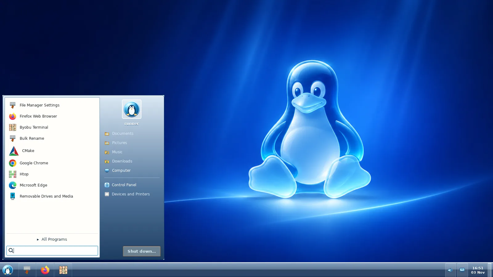

<div align="center">


# RiceBowl

**Seven desktop styles. One reversible XFCE session.**

A lightweight, native Python/GTK3 desktop customization hub for **Linux Mint XFCE and other XFCE/X11 desktops**.

[Get started](#get-started) · [Styles](#styles) · [Gallery](#gallery) · [Roadmaps](#roadmaps)

</div>

RiceBowl changes real Linux desktop elements—taskbar, Start/launcher, menus, system controls, wallpaper, GTK/XFWM4 themes, icons and Thunar styling. Applications and device controls use real Linux backends. No Electron, telemetry or proprietary OS assets.

> **Release status: 0.9.1+ development — not yet stable 1.0.** The [v0.9.1 pre-release](https://github.com/CopyPasteUser/RiceBowl/releases/tag/v0.9.1) remains the last tagged build. Recovery, diagnostics and Aqua hardware improvements passed native-X11 CI in [PR #65](https://github.com/CopyPasteUser/RiceBowl/pull/65) and [PR #66](https://github.com/CopyPasteUser/RiceBowl/pull/66); cross-rice Settings windows, Bluetooth scanning and the Hub update shortcut passed in [PR #67](https://github.com/CopyPasteUser/RiceBowl/pull/67). Per-rice geometry persistence, limited confirmed file-copy drops and a time-limited Aqua X11 display editor **passed virtual-X11 CI in [PR #68](https://github.com/CopyPasteUser/RiceBowl/pull/68)**. **5 November Frutiger follow-up:** [PR #69](https://github.com/CopyPasteUser/RiceBowl/pull/69) addresses the launcher Settings navigation trap and replaces prominent tray “More settings” prompts with direct, scrollable device-action menus. **Physical Mint/XFCE acceptance is still pending.** Full file-manager DnD and a riceExplorer renderer are **explicitly deferred until riceExplorer 1.0**.

| 1.0 workstream | Engineering status | Remaining gate |
| --- | --- | --- |
| Six non-macOS shells and stock XFCE recovery | ✅ Automated switching/rollback tests | Real login, HDMI and suspend tests |
| Health, opt-in update and performance report | ✅ Confirmed-update engine and Hub sidebar shortcut passed native GUI CI | Owner update/rollback drill on Mint |
| Rice-owned settings windows and drag-and-drop | ◐ Six non-macOS Settings windows save geometry; confirmed, copy-only file drops on XP/Win7/Aqua folders and Win98 desktop inspector; virtual-X11 CI green | Physical drag/drop and monitor tests; folder moves and wider file DnD after riceExplorer 1.0 |
| Frutiger Wi-Fi, sound, power, Bluetooth | ✅ Verified actions, on-demand BlueZ scan and direct taskbar flyout controls | Physical pairing/PIN confirmation, enterprise Wi-Fi |
| Frutiger calendar, USB mounts and media | ✅ GTK calendar, user-confirmed unmount, MPRIS controls | Physical-device checks and deeper polish |
| Aqua file manager and display arrangement | ◐ Native X11 monitor editor with independent 18 s rollback helper; virtual-X11 CI green; no renderer replacement | Real multi-monitor revert/confirm tests; riceExplorer renderer after its 1.0 |

Track every remaining item in the [1.0 roadmap](ROADMAP.md) and [owner acceptance sheet](ACCEPTANCE_1_0.md). The **macOS Aurora UI is intentionally unchanged**.
The [11 owner-reported interaction and styling issues](OWNER_QA_2026-11-05.md)
are tracked separately. [PR #72](https://github.com/CopyPasteUser/RiceBowl/pull/72)
merged Win98/Win7/XP/ChromeOS interaction fixes and extended Frutiger native
pointer checks with passing virtual-X11 CI. [PR #73](https://github.com/CopyPasteUser/RiceBowl/pull/73)
merged the separately confirmed dirty-checkout updater path. [PR #74](https://github.com/CopyPasteUser/RiceBowl/pull/74)
merged the Windows 10 Settings overhaul with passing native-X11 CI.
Automated checks do not replace physical Mint/XFCE acceptance.
For an unresolved Frutiger taskbar click on the owner's laptop, use the
[private on-demand click trace](FRUTIGER_QA_DIAGNOSTICS.md) to identify the event boundary.

## Styles

| Desktop | Distinctive experience |
| --- | --- |
| **macOS Aurora** | MacBar, MacMenu, Control Center and optional Plank dock |
| **[Windows 7 Aero](WIN7_AERO_ROADMAP.md)** | Glass Superbar, classic Start, window actions, Control Panel and native-history Action Center flag |
| **[Windows 10](WINDOWS10_ROADMAP.md)** | Flat taskbar and Start tiles, native Settings, network list, Task View and real device/notification controls |
| **[Windows XP Luna](XP_LUNA_ROADMAP.md)** | Blue/green taskbar, XP Start, Help and Control Panel |
| **[Windows 98 SE](CLASSIC_98_ROADMAP.md)** | Classic Start/Run/Find/Help, Quick Launch, System Properties and live device dialogs |
| **[ChromeOS](CHROMEOS_ROADMAP.md)** | Shelf, Launcher, Quick Settings, calendar and Settings |
| **[Frutiger Aero](FRUTIGER_AERO_ROADMAP.md)** | Aqua World launcher with Apps/Places/Settings escape navigation; scrollable Wi-Fi, sound, Bluetooth and power menus with direct actions, local calendar, USB/network mounts, MPRIS playback, X11 display readout |

All seven are installable profiles with separate visual identities. Their deeper feature-completion checklists remain open.

## Gallery



[View the full gallery — 32 current native-X11 screenshots across all rices](screenshots/current/README.md).

Screenshots are from a [passing 4 November 2026 GTK/XFWM4 CI run](https://github.com/CopyPasteUser/RiceBowl/actions/runs/41804502628), not mockups. Integrated macOS MacBar/Plank and physical-machine captures are still pending.

## Get started

Use an **XFCE session on X11**. Install prerequisites, then run the installer as your normal user:

```bash
sudo apt install -y git python3-gi python3-cairo python3-gi-cairo gir1.2-gtk-3.0 gir1.2-wnck-3.0
git clone https://github.com/CopyPasteUser/RiceBowl.git "$HOME/RiceBowl"
cd "$HOME/RiceBowl"
bash install.sh --dry-run
bash install.sh
"$HOME/.local/bin/ricebowl"
```

Installing does **not** apply a rice or stop XFCE Panel. Applying a style requires an explicit confirmation and creates a recovery snapshot.

### Update

From your existing checkout:

```bash
macrice doctor
macrice update check --refresh
macrice update apply --yes
```

For a strictly pinned CLI update, append `--revision <full SHA shown by check>`;
the Hub's confirmation always pins its reviewed revision automatically.

**No terminal needed:** The RiceBowl Hub has a visible **Check for updates**
button in its sidebar. After checking the trusted repository, it changes to
**Install update…** when new commits exist; installation requires confirmation.
Recovery also exposes the detailed update controls and read-only checks.
The updater accepts a clean official Git `main`, stages a pinned
revision and attempts archived recovery on install failure. It does **not**
verify signed releases or guarantee atomic multi-component rollback. For a
dirty checkout, the updater reports changed paths and leaves everything
untouched by default. The Hub now offers a separately confirmed **Install;
keep local files** action: it installs the official version while leaving the
Git source checkout at its previous revision. No stash or merge is attempted;
you must reconcile your source checkout yourself later. The equivalent CLI is
`macrice update check --refresh --preserve-checkout`, followed after reviewing
the changes by `macrice update apply --yes --preserve-checkout`. A source
checkout intentionally kept at its old revision may continue to report an
already-installed update as available. For a
manual source update, `cd "$HOME/RiceBowl" && git pull --ff-only && bash install.sh`
still works. Never run any installer/updater with `sudo`.

### Switch and recover

```bash
ricebowl                       # Open the hub
macrice rice plan aero-meadow  # Check the change without applying it
macrice rice apply aero-meadow # Apply Windows 7 Aero
macrice rice apply frutiger    # Switch to Aqua World
macrice rice restore           # Restore the previous desktop settings
macrice session-sync           # Reconcile the current session after login
macrice session-keys-restore   # Restore prior keyboard shortcuts
macrice performance report --samples 5 --json  # On-demand PSS/CPU/threads
macrice app-compat --select                     # Inspect a real app's window theme boundaries
```

The active rice uses **Super** for its launcher and **Right Ctrl** for Control Panel / Quick Settings. Managed assets and keyboard shortcuts are backed up; later user edits are not silently overwritten.
For apps whose title bars ignore XFWM (PhotoCraft, Thunderbird) see the
[read-only compatibility inspector and supported app settings](APP_COMPATIBILITY.md).
Windows 98, XP, Windows 7 and Windows 10 also offer a real Task Manager from
the blank taskbar's right-click menu when an XFCE/GNOME system monitor is installed.
The resource report includes the six non-macOS RiceBowl shells when running and does not install an always-on monitor. A failed shell startup or panel handoff attempts to recover the original XFCE panel and shortcuts. Check recovery on your real XFCE machine before relying on it unattended.

## Scope

- **XFCE/X11** is the supported target; Wayland and full Windows DWM-style blur are outside current support.
- **Thunar stays available.** [riceExplorer](https://github.com/CopyPasteUser/riceExplorer) is a separate, still-developing Rust file manager and is not yet the default.
- **Native windows are a cross-rice goal:** the Frutiger and XP control centers and Windows 10 Settings use independently focusable WM clients with draggable custom title regions; Windows 7/98/ChromeOS use native GTK frames. All six now save bounded, per-user positions/sizes and clamp restored windows **fully inside a monitor** after display changes. Existing XP/Win7/Aqua Places and the Windows 98 desktop inspector accept confirmed **local regular-file copies only** (with no overwrite and immediate conditional undo). Full directory/move/DnD integration awaits riceExplorer 1.0. [Window/DnD roadmap](RICE_WINDOWS_ROADMAP.md).
- **Riceware API 1.0:** shared, opt-in Linux backends for [riceSpice, ricePop, ricePlate and riceWine](RICEWARE_FOUNDATIONS.md). These are internal modules, not four additional background daemons.
- **Migration status:** XP Luna and Windows 7 Aero use riceSpice for taskbar status, real device flyouts and ricePlate desktop shortcuts; Windows 7 also reads ricePop history. **Windows 98 SE** has distinct classic device dialogs and a ricePlate inspector with external file drag sources and a confirmed Desktop copy target. **Windows 10** has verified hardware controls and ricePop history in Action Center. **ChromeOS** uses bounded riceSpice/ricePop for its Material You Shelf, Settings and notifications. **Frutiger Aero** uses the same verified worker for its Aqua Control Center, tray and scrollable **direct-action Wi-Fi, audio, Bluetooth, power and MPRIS flyouts**, plus a local calendar and Gio mounts with confirmed, asynchronous unmount. The app menu now dismisses synchronously when opening an Aqua Settings category, and Settings keeps visible Apps/Places exit buttons outside its scroll area. Flyout headers offer an unobtrusive full-settings gear, while real device actions remain the primary content. Nearby Bluetooth discovery is bounded and cancels on close; pairing delegates PIN approval to the default BlueZ system agent. The Aqua Display page offers an **opt-in temporary mode/position change** on one active monitor; its detached unprivileged guard reverts after 18 seconds without confirmation, including when Aqua closes. Physical unplug/crash/recovery acceptance remains unverified. Enterprise Wi-Fi flows remain system-owned. An Aqua notification flyout reads XFCE's real ricePop history. [Migration checklist](RICEWARE_MIGRATION_GUIDE.md). No default file manager or notification owner is replaced.
- **Windows 10 next-stage UI:** Its Start Settings entry opens a **separate Windows-10-styled Settings shell** with icon-first category Home, two-way search and real result destinations, keyboard navigation, Sound/Display/Notifications pages and readback-verified hardware switches with inline failure feedback. The taskbar network icon opens a real NetworkManager Wi-Fi list with rescan, connect/disconnect and truthful credential errors; Task View switches actual X11 windows and XFCE workspaces, with user-triggered create/move/safe-last-desktop removal. Where installed, Start offers an **opt-in RiceExplorer preview** using `rice-explorer --theme win10`, with Thunar left as the default. Global Win+I/Win+Tab bindings, deep per-category Settings features and physical hardware acceptance are **not complete**.
- Linux hardware availability and permissions determine which real actions are enabled. Missing capabilities are explained instead of simulated.
- All artwork is original. RiceBowl is not affiliated with Apple, Google or Microsoft.

## Roadmaps

- [RiceBowl 1.0 roadmap](ROADMAP.md) — shared session, release and hardware gates
- [Native windows and drag-and-drop](RICE_WINDOWS_ROADMAP.md) — cross-rice integration and acceptance
- [1.0 owner acceptance](ACCEPTANCE_1_0.md) — full switching, security, performance and hardware checklist
- [Riceware ecosystem](RICE_ECOSYSTEM_ROADMAP.md) — **riceExplorer, riceSpice, ricePop, ricePlate and riceWine** · [backend usage](RICEWARE_FOUNDATIONS.md)
- [Changelog](CHANGELOG.md) · [CI checks](https://github.com/CopyPasteUser/RiceBowl/actions) · [Contributing](CONTRIBUTING.md) · [MIT license](LICENSE)
