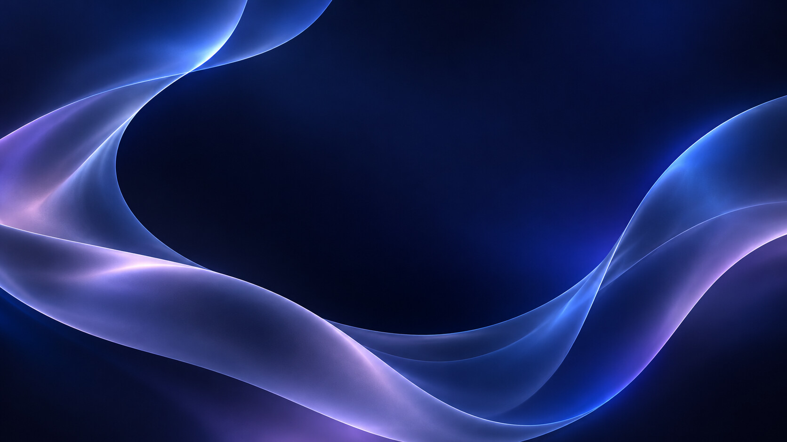
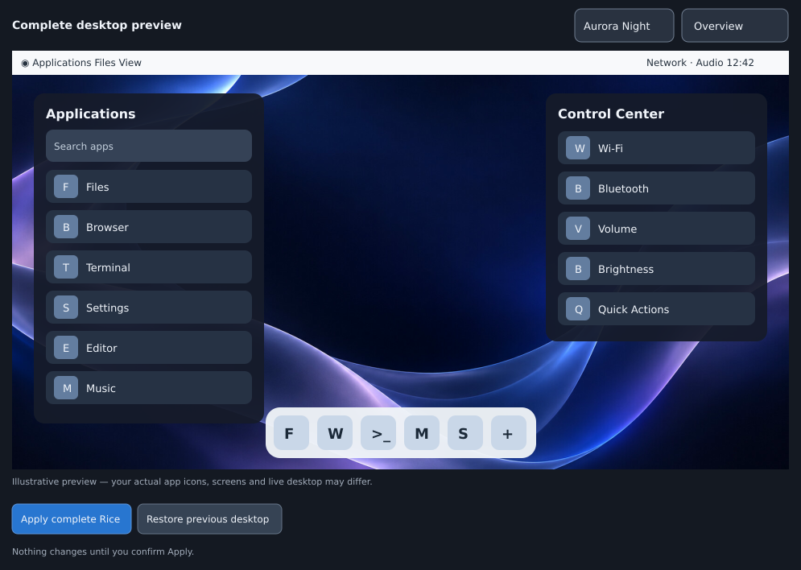
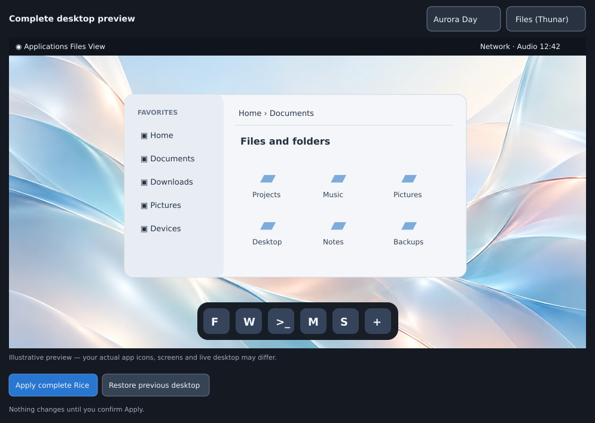

# Complete desktop Rice

MacRice can now style your **entire XFCE desktop**, not only its three bundled
apps. The feature is opt-in. The installer **never changes desktop settings**.

## What's included

| Part | Aurora Night | Aurora Day |
| --- | --- | --- |
| GTK3 & window borders | WhiteSur-Dark · window controls right | WhiteSur-Light · window controls right |
| Icons | WhiteSur-light | WhiteSur-light |
| Cursor | Bibata-Original-Classic, 24 px | Same |
| Fonts | Inter 10 / Inter Bold 10 | Same |
| Thunar | Dark Finder-inspired sidebar, breadcrumb path, icon view | Light Finder-inspired sidebar, breadcrumb path, icon view |
| MacBar (top bar) | **White**, dark text · live reload | **Black**, white text · live reload |
| Plank dock | **White glass** `MacRice-Frost-Glass` | **Black glass** `MacRice-Obsidian-Glass` |
| Plank geometry | Bottom · 60 px · intelligent hide · centered · zoom on | Same |
| MacMenu & Control Center | Midnight app themes | Light app themes |
| Wallpaper | [Aurora Night](assets/wallpapers/aurora-night.jpg) | [Aurora Day](assets/wallpapers/aurora-day.jpg) |

WhiteSur, Bibata, Inter and Plank are third-party components. **Install them
separately** from their respective upstreams or trusted distribution packages.
MacRice only references themes and fonts already present on your desktop. It
does not download theme archives or run package manager commands for you.







*These two release images are generated layout illustrations, not screenshots of
someone's real XFCE session. The interactive preview is a native GTK window.*

## Preview before applying

```bash
macrice preview
```

Or click **Desktop preview** in the MacRice manager. Switch between the two
wallpapers and the desktop/menu/control-center/Thunar layouts. This is a *conceptual*
preview of component placement, not a live screenshot of your current session.

The preview window has **Apply complete Rice** and **Restore previous desktop**
buttons. Both actions explain their scope and ask for confirmation.

If you're currently on Aurora Day and want Aurora Night, use the selector in
the preview and choose **Apply complete Rice**, or simply run:

```bash
macrice rice plan night    # Read-only check
macrice rice apply night   # Switch directly; no intermediate restore needed
```

## Safe command-line workflow

```bash
macrice rice plan night    # Read-only preflight: tools, installed assets, XFCE keys
macrice rice apply night   # Explicitly apply, with private backup and rollback
macrice rice restore       # Restore the latest applied desktop snapshot
```

Use `day` instead of `night` to select Aurora Day. If WhiteSur-Light is not
installed, its preflight stops without changing anything.

The backup snapshot is stored with private permissions under
`~/.local/share/macrice-state/backups/rice/`. Original wallpaper paths are recorded
only in that private local backup; they are never submitted to GitHub.
Wallpaper images are copied to a stable user-local location under
`~/.local/share/macrice-state/wallpapers/` so moving your cloned repository won't
break your background.

The two small, original translucent Plank themes are installed under
`~/.local/share/plank/themes/MacRice-Frost-Glass/` and
`MacRice-Obsidian-Glass/` as required. Their background colors use approximately
74–80% opacity, so the wallpaper gently shows through while icons stay clear.
Existing RC2 themes (`MacRice-Frost` and `MacRice-Obsidian`) are not overwritten
on upgrade, even if you customized them. The new Glass themes are user-local
appearance assets, not modified copies of WhiteSur. The
restore command restores your **previous Plank theme choice**; the two MacRice
theme files remain on disk, inactive, for subsequent switching.

Thunar's Finder-inspired styling is confined to `window.thunar` selectors in a
marked section of `~/.config/gtk-3.0/gtk.css`. Your own CSS outside that block
is preserved, including when switching Day/Night and restoring. MacRice also
enables Thunar's existing icon view, shortcuts sidebar and breadcrumb location
bar through its official XFConf preferences. Reopen Thunar to see its new GTK
styling. The system-wide WhiteSur GTK theme supplies the remaining window look.

## Safety and scope

- Reads all relevant XFConf, Thunar and Plank GSettings values **before** writing.
- Validates WhiteSur/Icon/Bibata/Inter availability and both bundled wallpapers.
- Sets only XFCE GTK/WM/icon/cursor/font fields, three Thunar view preferences,
  one scoped GTK CSS block, Plank appearance fields, existing XFCE wallpaper
  keys, and the three apps' own theme fields.
- Leaves pinned dock apps, panel configuration, autostart, network, Bluetooth,
  XFCE keyboard shortcuts, personal notes and favorites untouched.
- Updates existing XFCE workspace wallpaper properties; it doesn't invent
  screen or monitor IDs on hardware it has never seen.
- Restores previous values on a failed apply. On `rice restore`, settings still
  matching MacRice's applied values are restored, and later custom edits are
  preserved individually. Any skipped settings are printed by the CLI/preview
  and recorded in `skipped.json` next to the private desktop backup.
- MacBar observes its own JSON configuration and changes between white/black
  without a restart or a background polling loop.
- Does not require root, download third-party themes or replace the XFCE Panel.

If no wallpaper properties exist, first choose any wallpaper once in XFCE's
**Desktop Settings** so the desktop creates the correct screen/workspace
entries. Then retry the read-only preflight.

For your known Linux Mint 22.1 WhiteSur-Dark configuration, Aurora Night
matches the reported GTK/WM/icons/cursor/font and Plank values. Actual
multi-monitor and session-restart behavior still requires testing on your
ThinkPad before stable 1.0.
