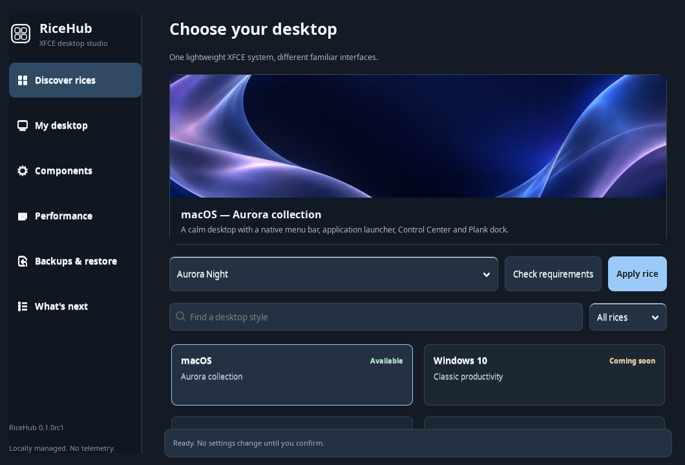
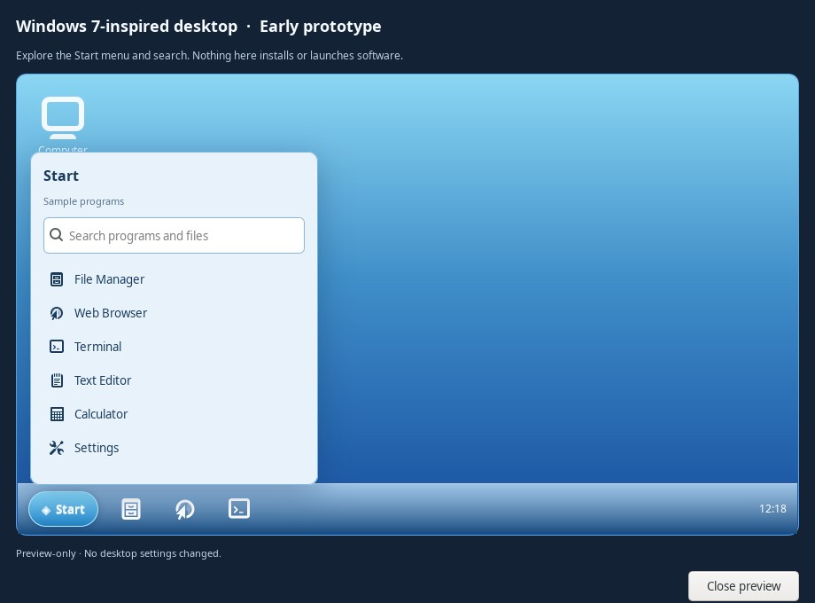

# RiceHub · Desktop styles for XFCE

RiceHub is the beginning of a bigger idea: one lightweight home for complete XFCE rices inspired by operating systems we know and love. The project is built around **a working system first, an honest roadmap second**. The macOS implementation comes from the existing MacRice projects. Windows 7 has an interactive design prototype; Windows-inspired desktops still cannot be applied.

## First launch

The main installer installs both the old MacRice CLI and the new RiceHub desktop entry. It does not change GTK, icons, Plank or your XFCE Panel unless you explicitly apply a rice later.

```bash
bash install.sh --dry-run   # Preview without changing anything
bash install.sh             # Install as your normal user, never with sudo
ricehub                     # Open the new hub
```

If you prefer the existing command, `macrice hub` opens the same app; `macrice gui` still opens the older MacRice settings manager.

### Where to start

1. **Discover rices:** Pick macOS and one of Aurora Night, Aurora Day, Liquid Glass Night, Liquid Glass Day or Classic Aqua. Look at the preview and click **Check requirements** before applying. Missing WhiteSur, Bibata or Inter assets are reported as requirements; they are never silently downloaded.
2. **Apply rice:** Review and confirm the changes. The engine saves a private recovery snapshot first, then styles XFCE GTK and window decorations, Thunar, MacMenu, Control Center, MacBar, the wallpaper and Plank.
3. **My desktop:** Check the effective desktop configuration if a theme doesn't look right.
4. **Backups & restore:** Restore the last active snapshot. The restore engine attempts to protect later manual edits. It cannot promise to reverse changes made by unrelated software.
5. **Components:** Toggle the already installed menu and Control Center, start the bar/dock, or explicitly repair bundled apps.
6. **Performance:** Choose a resource profile and run an on-demand memory/CPU snapshot. There is no extra monitoring service.

The desktop remains usable if your XFCE configuration is different, but **the full macOS rice currently targets XFCE/X11**. Try it on a non-critical account before replacing your panel.

## What is available?

| Rice family | Status | Planned identity |
| --- | --- | --- |
| macOS / Aurora collection | **Available (preview)** | MacBar, MacMenu, Control Center, Plank, five full desktop palettes and Thunar styling |
| Windows 10 | Coming soon | Left-aligned taskbar, Start menu, action area and clean productivity styling |
| Windows 11 | Coming soon | Centered taskbar, rounded launcher, quick settings, light/dark modes |
| Windows 7 | **Interactive, preview-only prototype** | Original Aero-inspired desktop, toggleable Start menu, sample program search; actual system styling still coming soon |

Windows 10 and 11 are **read-only descriptions**. Windows 7's prototype is interactive but does not launch applications or make system changes. None of the Windows families shows an Apply button; none installs packages or changes your current desktop.

### Genuine interface screenshots





These are captures of the running GTK3 application on an XFCE/X11 test session, not design renders. For a side-by-side view of the gallery card and prototype, see the [README](README.md#windows-7-first-interactive-prototype).

## Product roadmap

**0.1 preview — available now**

- [x] Native GTK3 gallery with search, filters, working availability badges and a responsive wallpaper preview.
- [x] All five existing macOS rices via the shared MacRice engine.
- [x] Desktop status, components, performance and backup/recovery pages.
- [x] Owned user-local RiceHub launcher, desktop entry, icon and compatibility with existing MacRice.
- [x] Explicit confirmation, read-only preflight and honest Coming soon states.
- [x] Interactive Windows 7 Start menu design prototype with sample search and no installer or XFCE writes.
- [x] Publish genuine RiceHub and Windows 7 preview screenshots.
- [x] No new long-running process when the hub is closed.

**0.2 — dependable switching and onboarding**

- [ ] System compatibility score with package/theme installation instructions.
- [ ] More resilient migration and a recovery wizard with individual settings selection.
- [ ] Full keyboard-only, touch, HiDPI and small-screen testing on physical XFCE laptops.
- [ ] Additional desktop screenshots from physical supported XFCE hardware, with measured startup and memory budgets.

**0.4 — Windows 10 preview**

- [ ] Separate, reversible XFCE panel and Start-style application menu configuration.
- [ ] Taskbar styling, icon set, window theme and wallpapers, with regression tests.
- [ ] Shared preset contract so each rice uses the same plan, apply and restore pipeline.

**0.6 — Windows 11 and Windows 7**

- [ ] Centered Windows 11-inspired taskbar and quick settings.
- [ ] Turn the Windows 7 visual prototype into a reversible classic menu/taskbar rice, with optional compositor-dependent transparency.
- [ ] Theme import/export and optional community-authored presets with transparent provenance.

**0.8 — hub polish**

- [ ] Guided install/update of optional required themes from trusted package sources.
- [ ] Reliable upgrades, independent profile switching and conflict diagnostics.
- [ ] Validated per-rice screenshots, accessibility pass and performance regression suite.

**1.0 — stable rice hub**

- [ ] All available rices tested on supported XFCE/X11 releases.
- [ ] Crash-safe backups and restore from interrupted or outdated installations.
- [ ] Clear privacy, theme-asset licensing, release checksums and one-command updates.

## Why the existing repos are still here

The current suite keeps MacMenu, Control Center and MacBar as self-contained components within this source tree. Their existing standalone repositories remain available; we haven't deleted them or rewritten their histories. As the hub grows, the shared catalog and install/rollback logic can move into a single core without creating a separate GitHub repository for every Windows-like theme.

## Contribution and originality

These interfaces are *inspired by* familiar desktops; RiceHub is not affiliated with Apple or Microsoft and does not include their proprietary assets. The original Aurora wallpapers and monochrome RiceHub mark are included. The project is vibe-coded and human-directed with assistance from ChatGPT / OpenAI Codex; see [CONTRIBUTORS.md](CONTRIBUTORS.md).
