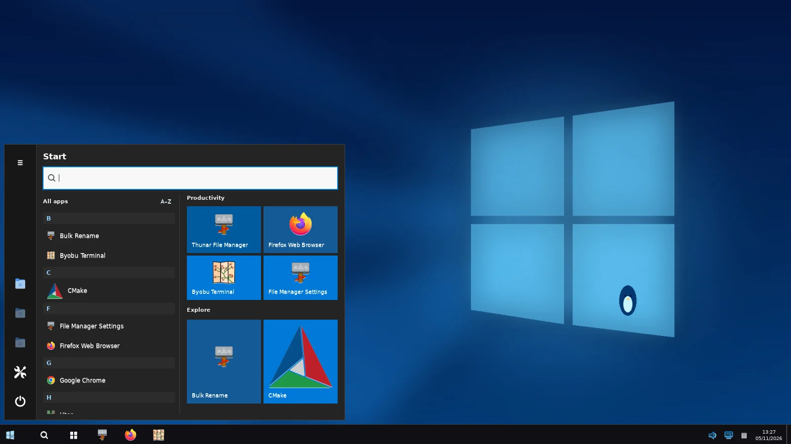

> **RiceBowl 0.7 (3 November 2026):** This is the historical RiceHub architecture and rollback document. The current application is named RiceBowl; see [RICEBOWL.md](RICEBOWL.md) for 0.7 changes and [README.md](README.md) for installation. Internal state, legacy commands and D-Bus IDs remain compatible.

# RiceBowl · Historical architecture and release roadmap

RiceBowl began as RiceHub and is built around one idea: one lightweight home for complete XFCE rices inspired by operating systems we know and love. The project is built around **a working system first, an honest roadmap second**. The macOS implementation comes from the existing MacRice projects. Release 0.6 adds four installable styles with original artwork and shared taskbar behavior; physical Mint/XFCE acceptance toward 1.0 is still open. The separate concept dialogs stay strictly read-only; see [the acceptance plan](CONCEPTS.md).

## First launch

The main installer installs both the old MacRice CLI and the RiceBowl desktop entry. It does not change GTK, icons, Plank or your XFCE Panel unless you explicitly apply a rice later.

```bash
bash install.sh --dry-run   # Preview without changing anything
bash install.sh             # Install as your normal user, never with sudo
ricebowl                    # Open the current manager
ricehub                     # Retained legacy shortcut
```

If you prefer the existing command, `macrice hub` opens the same app; `macrice gui` still opens the older MacRice settings manager.

### Where to start

1. **Discover rices:** Pick any of the seven families, including XP, Classic, ChromeOS or Frutiger, and click **Check requirements** before applying. Missing prerequisites are reported rather than silently downloaded. The separate interactive concept dialogs never write desktop settings; the primary **Apply rice** action installs an actual desktop style.
2. **Apply rice:** Review and confirm the changes. The engine saves a private recovery snapshot first, then styles XFCE GTK and window decorations, Thunar, MacMenu, Control Center, MacBar, the wallpaper and Plank.
3. **My desktop:** Check the effective desktop configuration if a theme doesn't look right.
4. **Backups & restore:** Restore the last active snapshot. The restore engine attempts to protect later manual edits. It cannot promise to reverse changes made by unrelated software.
5. **Components:** Toggle the already installed menu and Control Center, start the bar/dock, or explicitly repair bundled apps.
6. **Windows 7:** Select Aero Seven Blue or Aero Seven Night. Check requirements, apply, then use the GTK Superbar and Start menu. The menu indexes real `.desktop` launchers; the Aero session login entry is managed with the same backup/restore protections. A separate read-only preview is also available.
7. **Performance:** Choose a resource profile and run an on-demand memory/CPU snapshot. There is no extra monitoring service.
8. **Windows 10:** Choose Midnight or Blue, check requirements, then apply. The actual shell searches and launches installed apps, shares real pinned launchers between Start tiles and the taskbar, tracks windows with Wnck, and provides XFCE quick-setting shortcuts. The older read-only concept dialog remains available.

The desktop remains usable if your XFCE configuration is different, but **the full macOS rice currently targets XFCE/X11**. Try it on a non-critical account before replacing your panel.

## What is available?

| Rice family | Status | Planned identity |
| --- | --- | --- |
| macOS / Aurora collection | **Installable** | MacBar, MacMenu, Control Center, Plank, three full desktop palettes and Thunar styling |
| Windows 10 | **Installable** | Two dark/light themes, original penguin icons and wallpapers, live taskbar, Gio Start and pinned tiles, Action Center and safe restore |
| Windows 7 | **Installable** | Cobalt Aero Seven Blue / Night Linux-penguin wallpaper, gold folder icons, classic GTK/XFWM chrome, Thunar, glass Superbar and searchable Start menu |
| Windows XP Luna | **Installable 0.6** | Blue/green taskbar, real searchable Start, original GTK/XFWM chrome, meadow wallpaper |
| Windows 98 / 2000 | **Installable 0.6** | Teal desktop, compact gray live taskbar and classic Start |
| ChromeOS | **Installable 0.6** | Pastel desktop, light shelf, centered live app drawer and quick settings |
| Y2K / Frutiger Aero | **Installable 0.6** | Eco-futurist aqua shell, original landscape, searchable launcher and live window list |

All seven families can be applied only after a read-only preflight and explicit confirmation; the *separate concept dialogs* are harmless demos. They install only original assets in the user's home, save a restore snapshot, and change the selected XFCE, Plank and session appearance. Nothing installs packages or overwrites third-party themes. The four new families share the proven Aero/Ten Gio, Wnck, SNI, keyboard and recovery foundation rather than running a second independent panel implementation.

The Aero taskbar includes persistent right-click pins, a two-line clock, bounded/paged searchable Start menu, Show Desktop, native settings shortcuts and **optional live window switching**. Install `gir1.2-wnck-3.0` on Linux Mint XFCE to enable event-driven Wnck window buttons (activate, minimize, restore and overflow); without it, pinned launchers still work. An **experimental StatusNotifier (SNI) tray** is available by default, using an existing watcher when present or a session-local fallback when none exists. Legacy XEmbed tray icons remain unsupported. Set `RICEHUB_AERO_TRAY=0` to disable the host. Optional `RICEHUB_AERO_GLASS=1` enables a more translucent gradient; it does **not** provide background blur and depends on the compositor for its visual result. The Aero shell can reserve the bottom X11 workarea using EWMH, opt-out with `RICEHUB_AERO_RESERVE=0`; existing XFCE panels and MacBar are never force-killed. For all individual components and assets, see [WINDOWS7.md](WINDOWS7.md).

### Genuine interface screenshots


The [Windows 7 gallery](WINDOWS7.md#screenshots--coverage) and current
[README](README.md#current-screenshots) show native virtual-X11 captures from
the same passing 4 November 2026 CI run. Earlier release illustrations are
not presented as current screenshots.



The [Windows 10 release gallery and completion roadmap](WINDOWS10.md#release-roadmap-and-acceptance) includes Action Center and the installable theme selection. These are genuine live GTK screenshots in a disposable X11 desktop fixture, **not** physical Linux Mint hardware acceptance.

The other desktop styles and the standalone dark MacMenu appear in the
[current README gallery](README.md#current-screenshots). The [full 32-image
gallery](screenshots/current/README.md) also covers Control Panels, genuine
Thunar windows, ChromeOS Settings/Notifications and XP Luna deep interactions.
All captures use GTK3 under isolated X11; no physical machine was modified.

## Product roadmap

**0.6.0 — four more installable desktops**

- [x] Native GTK preview, launcher search, sample file manager, task buttons and explicit no-write labeling for XP, Classic, ChromeOS and Frutiger Aero.
- [x] Publish original GTK/XFWM/icon artwork, native themed taskbar styles and four wallpapers.
- [x] Integrate CLI apply/restore, versioned snapshot schema, managed autostart, exclusive taskbar handoff and Super/Right Ctrl toggles.
- [x] Automated GTK/X11 smoke tests and genuine menu/control screenshots for all four new rices.
- [ ] Physical visual/keyboard acceptance, fast switching, multi-monitor and long-running crash checks on real Mint XFCE before the 1.0 milestone; see [CONCEPTS.md](CONCEPTS.md).

**0.1 preview — foundation**

- [x] Native GTK3 gallery with search, filters, working availability badges and a responsive wallpaper preview.
- [x] All three currently supported macOS rices via the shared MacRice engine.
- [x] Desktop status, components, performance and backup/recovery pages.
- [x] Owned user-local RiceHub launcher, desktop entry, icon and compatibility with existing MacRice.
- [x] Explicit confirmation, read-only preflight and honest Coming soon states.
- [x] Interactive Windows 7 design prototype with sample search and no XFCE writes.
- [x] Publish genuine RiceHub and Windows 7 preview screenshots.
- [x] No new long-running process when the hub is closed.

**0.2 — original Aero rice — experimental now**

- [x] Two original Aero wallpapers and Linux penguin Start symbol.
- [x] Bundled user-local GTK3, XFWM4 and icon artwork; matching Thunar and glass Plank palette.
- [x] Actual searchable Start menu for installed applications and bottom taskbar with event-driven app catalog updates.
- [x] Optional live window task buttons, active-window highlights, minimize/restore and a compact overflow menu using event-driven X11 Wnck signals.
- [x] Reversible Aero apply/restore, managed session autostart and non-overlapping Plank configuration.
- [x] Updated RiceHub and Start menu screenshots; illustrative macOS + Plank desktop overview.
- [ ] Physical Mint XFCE / X11 hardware tests of window decorations and compositor variations.

**0.3 RC2 — Windows 7 Aero feature-complete candidate**

- [x] Persistent user-configurable taskbar pins with atomic, validated preference storage.
- [x] Responsive Start placement, paged all-program catalog, keyboard search and safe XFCE actions.
- [x] Show Desktop, date and time, native sound/network shortcuts, task overflow and X11 bottom workarea reservation.
- [x] Experimental SNI tray with bounded icon processing, hover tooltips and correctly positioned context menu calls.
- [x] GTK/X11 real-launch smoke test in GitHub CI, plus pure-logic regression coverage for pins, layout and D-Bus values.
- [x] Full Windows 7 component/asset inventory and release acceptance checklist.
- [ ] Physical X11 hardware validation, current screenshots of every feature, SNI interoperability and measured resource budgets.

**0.3 — dependable switching and onboarding**

- [ ] System compatibility score with package/theme installation instructions.
- [ ] More resilient migration and a recovery wizard with individual settings selection.
- [ ] Full keyboard-only, touch, HiDPI and small-screen testing on physical XFCE laptops.
- [ ] Additional desktop screenshots from physical supported XFCE hardware, with measured startup and memory budgets.

**0.4 — Windows 10 concept (completed)**

- [x] Interactive native GTK3 Start preview with case-insensitive sample search and honest no-result state.
- [x] Original blue wallpaper, flat dark taskbar, tile group and Action Center prototype.
- [x] Real virtual-display screenshots and automated preview capture in CI, no desktop writes.

**0.5 RC1 — complete installable Windows 10-inspired rice**

- [x] Live, event-driven dark taskbar, independent Start menu, installed-application search, persistent pins and pinned app tiles.
- [x] Shared real Wnck window switching, Show Desktop, optional StatusNotifier tray, keyboard dismissal and quick XFCE settings actions.
- [x] Two original light/dark XFWM4/GTK themes, flat icons, original high-resolution wallpapers, Thunar and Plank styling.
- [x] Full plan/apply/restore with independent managed autostarts, schema 4 snapshots, rollback and cross-rice switching (Windows 7 ↔ Windows 10).
- [x] Native style picker, CLI integration, versioned real-GTK screenshots and X11 smoke tests in CI.
- [ ] Physically test all integration points on Linux Mint XFCE, multiple resolutions and HiDPI; measure resource budgets and audit panel coexistence before declaring 1.0. See [the specific acceptance cases](WINDOWS10.md#release-roadmap-and-acceptance).

**0.6 — Cross-rice quality and mature Windows 7**

- [x] Add experimental StatusNotifier tray support, with bounded icon decoding and safe coexistence with other tray hosts.
- [x] Add opt-in translucent Aero styling (`RICEHUB_AERO_GLASS=1`), without claiming compositor blur.
- [ ] Add legacy XEmbed compatibility if needed, and validate SNI compatibility and visual behavior on physical XFCE/X11 hardware.
- [ ] Theme import/export and optional community-authored presets with transparent provenance.

**0.8 — hub polish**

- [ ] Guided install/update of optional required themes from trusted package sources.
- [ ] Reliable upgrades, independent profile switching and conflict diagnostics.
- [ ] Validated per-rice screenshots, accessibility pass and performance regression suite.

**1.0 — stable rice hub**

- [ ] All available rices tested on supported XFCE/X11 releases.
- [ ] Crash-safe backups and restore from interrupted or outdated installations.
- [ ] Clear privacy, theme-asset licensing, release checksums and one-command updates.

## Why the existing repos are still here

The current suite keeps MacMenu, Control Center and MacBar as self-contained components within this source tree. Their existing standalone repositories remain available; we haven't deleted them or rewritten their histories. As the hub grows, the shared catalog and install/rollback logic can move into a single core without creating a separate GitHub repository for every Windows-like theme.

## Contribution and originality

These interfaces are *inspired by* familiar desktops; RiceBowl is not affiliated with Apple or Microsoft and does not include their proprietary assets. The original Aurora wallpapers and monochrome RiceHub mark are included. The project is vibe-coded and human-directed with assistance from ChatGPT / OpenAI Codex; see [CONTRIBUTORS.md](CONTRIBUTORS.md).
