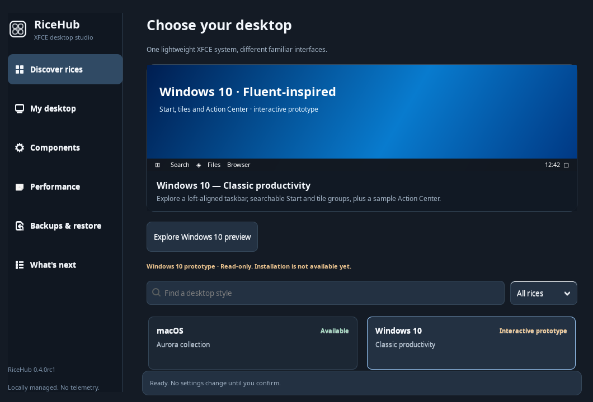
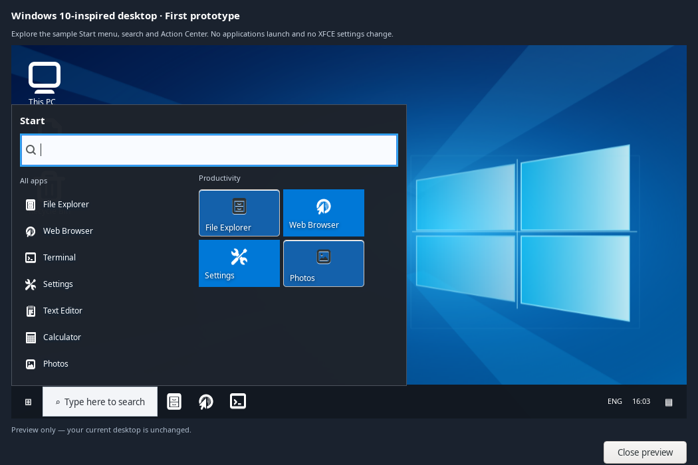
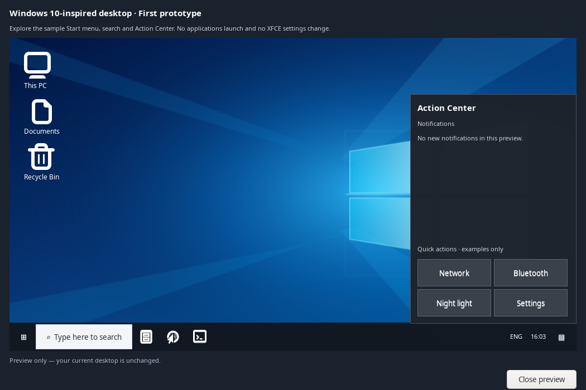

# Windows 10 concept — prototype 0.4 RC1

The first Windows 10-inspired RiceHub prototype is a **native GTK3 interactive preview**, not an installable XFCE theme yet. It uses original RiceHub blue wallpaper artwork and no copied Windows icons, system files or Microsoft imagery.

## What's working

- Familiar left-aligned dark taskbar with Start button, search, sample pinned apps, clock and Action Center button.
- Dark Start menu with a search field, case-insensitive sample app filtering, empty-result message and a group of blue productivity tiles.
- Action Center with a sample notification state and four clearly marked example quick actions.
- Real button focus, clickable preview entries, Escape dismissal, and mutually exclusive Start / Action Center overlays.
- Opens directly from **RiceHub → Discover → Windows 10 → Explore Windows 10 preview**. Closing the dialog leaves the desktop unchanged.

The example app buttons intentionally **do not launch** real applications. The quick-action buttons **do not toggle** Wi-Fi, Bluetooth, brightness or other system settings. They display an explicit feedback message. The profile has no *Apply rice* action because a reversible Windows 10 XFCE installation is not yet implemented.

## Genuine GTK prototype captures



| Start and sample app tiles | Action Center and original wallpaper |
| --- | --- |
|  |  |

All three images were captured directly from running GTK3 windows in a temporary X11 virtual display using the [dialog capture](screenshots/capture_windows10.py) and [RiceHub capture](screenshots/capture_windows10_hub.py) scripts. They are **real UI screenshots**, not a screenshot of a complete installed XFCE rice. Fonts, system icons, wallpaper cropping and window decorations may differ on actual Linux Mint systems. No production desktop settings were altered during capture.

## Next milestones

1. Implement a separate Windows 10 XFCE shell with a live Gio app catalog, event-driven Wnck window list, tray support, notifications and desktop-specific Start placement. Reuse the proven Aero shell backends where possible.
2. Add original light/dark GTK, XFWM4 and icon styles plus a Windows 10-style file-manager appearance.
3. Extend the shared RiceHub plan/apply/restore engine to switch the selected shell safely, including panel coexistence, autostart, and rollback after interruption.
4. Test on real Linux Mint XFCE/X11 at 1366×768, 1920×1080 and HiDPI; capture genuine installed-desktop screenshots and measure memory/idle CPU.

## Validate locally

```bash
/usr/bin/python3 -m unittest tests.test_windows10 tests.test_hub -v
# On an X11 desktop, or under xvfb-run if installed:
/usr/bin/python3 screenshots/capture_windows10.py
```

This work is independent of the currently installable macOS and Aero profiles; their settings and recovery paths are unchanged.
