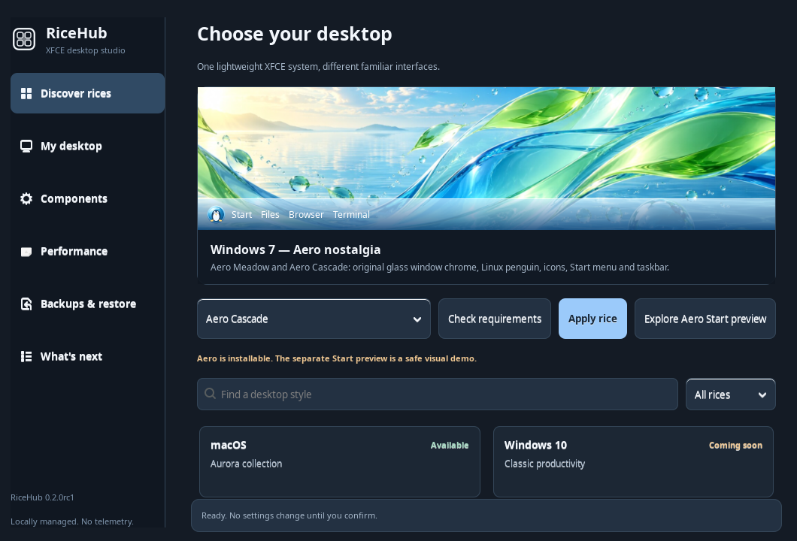
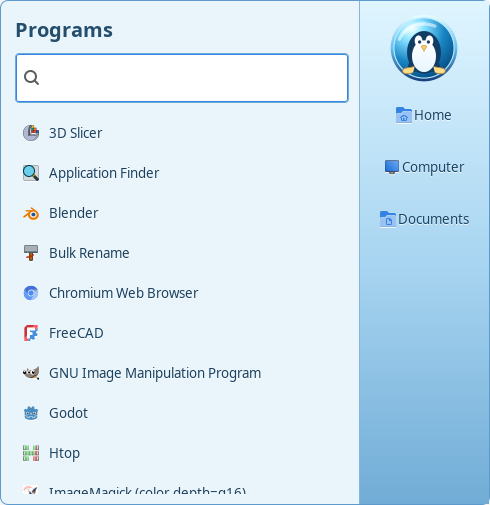

# Windows 7 · Aero Rice — complete component inventory

**RiceHub 0.3 release candidate · Windows 7 Aero feature set.** Original Linux-themed artwork inspired by the Aero era; not an installation of Microsoft Windows or a pixel-identical distribution. No Microsoft assets are included.

## Preview





These are **older genuine GTK3 screenshots** of the base Aero implementation, not new captures of the final layout. The new tray, clock, pins, Show Desktop and responsive layout still require physical-machine screenshots.

## What is included

| Desktop area | Implementation | Details |
| --- | --- | --- |
| **Start orb** | [Aero Penguin](assets/aero-penguin.svg) | Original branded Linux Start button; toggles a real GTK window |
| **Start menu** | [aero_shell.py](macrice/aero_shell.py) | Installed desktop programs, search, Enter/Escape/Down keyboard operation, paging, Home/Computer/Documents, Control Panel, safe XFCE session dialog |
| **Taskbar** | [aero_shell.py](macrice/aero_shell.py) | Original Aero gradient, active window indicator, minimize/restore, title ellipsis, overflow and primary-monitor layout |
| **Pinned applications** | [aero_pins.py](macrice/aero_pins.py) | Right-click a Start result to pin, right-click taskbar icon to unpin; 6 persistent launchers maximum |
| **Show Desktop** | [aero_windows.py](macrice/aero_windows.py) | Via optional Wnck on X11; disabled if Wnck is unavailable |
| **Notification area** | [aero_tray.py](macrice/aero_tray.py) | Experimental D-Bus StatusNotifier icons, click and context menu, coexists with an existing watcher |
| **Clock / quick links** | [aero_shell.py](macrice/aero_shell.py) | Date and time, optional direct native network and sound settings (launchers, not simulated connection state) |
| **Glass** | [Aero shell CSS](macrice/aero_shell.py) | Glass-inspired gradient, optional translucent variant; no compositor blur guarantee |
| **Window decoration** | [XFWM4 theme](assets/themes/RiceHub-Aero/xfwm4/) | Real minimize, maximize, close, shading, sticky, border and title button artwork |
| **GTK widgets** | [GTK3 theme](assets/themes/RiceHub-Aero/gtk-3.0/gtk.css) | Unified buttons, menus, controls and palettes |
| **Application / places icons** | [RiceHub-Aero icon theme](assets/icons/RiceHub-Aero/) | Original scalable SVG set and FreeDesktop fallback to installed icons |
| **File manager** | [Thunar integration](macrice/thunar.py) | Reversible application styling |
| **Dock** | [Aero glass Plank theme](assets/plank-themes/RiceHub-Aero-Glass/dock.theme) | Existing Plank configuration shifted away from the bottom taskbar during Aero apply |
| **Wallpapers** | [Meadow](assets/wallpapers/aero-meadow.jpg) / [Cascade](assets/wallpapers/aero-cascade.jpg) | Two original Frutiger Aero-style desktops |
| **Session startup** | [aero.py](macrice/aero.py) | RiceHub-managed, user-local XFCE autostart; no global systemd service |
| **Backup and restore** | [rice.py](macrice/rice.py) | Explicit preflight, snapshot, apply, restore, preservation of later user edits where possible |
| **Hub gallery** | [hub.py](macrice/hub.py) | Select either Aero palette; check requirements before applying |
| **Concept preview** | [windows7_proto.py](macrice/windows7_proto.py) | Separate non-installing visual prototype, distinct from the real shell |
| **Small-screen geometry** | [aero_layout.py](macrice/aero_layout.py) | Bounded Start menu, task overflow and conservative EWMH bottom workarea reservation |

## Install, activate, revert

Supported target: Linux Mint XFCE running an **X11** session. Optional Wnck is required for active-window buttons and Show Desktop.

```bash
sudo apt install python3-gi gir1.2-gtk-3.0 gir1.2-wnck-3.0 librsvg2-common
git clone https://github.com/CopyPasteUser/RiceHub.git
cd RiceHub
bash install.sh --dry-run
bash install.sh                   # Never sudo for RiceHub itself
macrice rice plan aero-meadow    # Read-only preflight
macrice rice apply aero-meadow   # Explicit change + backup
macrice rice apply aero-cascade  # Alternative palette
macrice rice restore             # Restore previous rice snapshot
```

Use `macrice aero-shell` to open/toggle Start and `macrice aero-shell --quit` to stop the resident shell. The ordinary installer does **not** activate Aero, replace XFCE Panel or alter your wallpaper.

### Customization and compatibility

- **Taskbar pins:** Right-click a program in the Start search results to **Pin to taskbar**; right-click its taskbar icon to **Unpin**. The list is stored atomically in `${XDG_CONFIG_HOME:-~/.config}/ricehub/aero-pins.json`. No shell commands are read from this file; only validated desktop IDs.
- **Translucent look:** Relaunch with `RICEHUB_AERO_GLASS=1 macrice aero-shell`. This is translucent styling, **not** true wallpaper blur. A compositor and RGBA support determine its appearance.
- **Tray opt-out:** Use `RICEHUB_AERO_TRAY=0 macrice aero-shell` if another tray implementation conflicts.
- **Workarea opt-out:** Use `RICEHUB_AERO_RESERVE=0 macrice aero-shell` if you deliberately keep another bottom dock/panel. Otherwise, Aero reserves the root bottom edge through standard X11 EWMH hints where geometry permits.
- **Persistent environment overrides:** Set them in your session environment before XFCE autostart; invoking an existing process with a new environment does not alter that process.
- **System actions:** Control Panel and Log off launch existing XFCE dialogs. There is no immediate shutdown, no shell execution of untrusted text, and no automatic package installation.
- **Dependencies:** Optional SNI and Wnck are degraded gracefully if absent. Legacy XEmbed tray icons are **not** implemented.
- **Coexistence:** RiceHub never force-kills an existing XFCE Panel or MacBar when applying a rice; disable redundant panels yourself only after checking recovery.

## Visual assets — every bundled Aero element

### Desktop backgrounds and identity

- [assets/aero-penguin.svg](assets/aero-penguin.svg)
- [assets/wallpapers/aero-cascade.jpg](assets/wallpapers/aero-cascade.jpg)
- [assets/wallpapers/aero-meadow.jpg](assets/wallpapers/aero-meadow.jpg)

### GTK theme

- [gtk.css](assets/themes/RiceHub-Aero/gtk-3.0/gtk.css)

### Window decorations (all XFWM4 states)

- [bottom-active.png](assets/themes/RiceHub-Aero/xfwm4/bottom-active.png)
- [bottom-inactive.png](assets/themes/RiceHub-Aero/xfwm4/bottom-inactive.png)
- [bottom-left-active.png](assets/themes/RiceHub-Aero/xfwm4/bottom-left-active.png)
- [bottom-left-inactive.png](assets/themes/RiceHub-Aero/xfwm4/bottom-left-inactive.png)
- [bottom-right-active.png](assets/themes/RiceHub-Aero/xfwm4/bottom-right-active.png)
- [bottom-right-inactive.png](assets/themes/RiceHub-Aero/xfwm4/bottom-right-inactive.png)
- [close-active.png](assets/themes/RiceHub-Aero/xfwm4/close-active.png)
- [close-inactive.png](assets/themes/RiceHub-Aero/xfwm4/close-inactive.png)
- [close-prelight.png](assets/themes/RiceHub-Aero/xfwm4/close-prelight.png)
- [close-pressed.png](assets/themes/RiceHub-Aero/xfwm4/close-pressed.png)
- [hide-active.png](assets/themes/RiceHub-Aero/xfwm4/hide-active.png)
- [hide-inactive.png](assets/themes/RiceHub-Aero/xfwm4/hide-inactive.png)
- [hide-prelight.png](assets/themes/RiceHub-Aero/xfwm4/hide-prelight.png)
- [hide-pressed.png](assets/themes/RiceHub-Aero/xfwm4/hide-pressed.png)
- [left-active.png](assets/themes/RiceHub-Aero/xfwm4/left-active.png)
- [left-inactive.png](assets/themes/RiceHub-Aero/xfwm4/left-inactive.png)
- [maximize-active.png](assets/themes/RiceHub-Aero/xfwm4/maximize-active.png)
- [maximize-inactive.png](assets/themes/RiceHub-Aero/xfwm4/maximize-inactive.png)
- [maximize-prelight.png](assets/themes/RiceHub-Aero/xfwm4/maximize-prelight.png)
- [maximize-pressed.png](assets/themes/RiceHub-Aero/xfwm4/maximize-pressed.png)
- [menu-active.png](assets/themes/RiceHub-Aero/xfwm4/menu-active.png)
- [menu-inactive.png](assets/themes/RiceHub-Aero/xfwm4/menu-inactive.png)
- [menu-prelight.png](assets/themes/RiceHub-Aero/xfwm4/menu-prelight.png)
- [menu-pressed.png](assets/themes/RiceHub-Aero/xfwm4/menu-pressed.png)
- [right-active.png](assets/themes/RiceHub-Aero/xfwm4/right-active.png)
- [right-inactive.png](assets/themes/RiceHub-Aero/xfwm4/right-inactive.png)
- [shade-active.png](assets/themes/RiceHub-Aero/xfwm4/shade-active.png)
- [shade-inactive.png](assets/themes/RiceHub-Aero/xfwm4/shade-inactive.png)
- [shade-prelight.png](assets/themes/RiceHub-Aero/xfwm4/shade-prelight.png)
- [shade-pressed.png](assets/themes/RiceHub-Aero/xfwm4/shade-pressed.png)
- [stick-active.png](assets/themes/RiceHub-Aero/xfwm4/stick-active.png)
- [stick-inactive.png](assets/themes/RiceHub-Aero/xfwm4/stick-inactive.png)
- [stick-prelight.png](assets/themes/RiceHub-Aero/xfwm4/stick-prelight.png)
- [stick-pressed.png](assets/themes/RiceHub-Aero/xfwm4/stick-pressed.png)
- [themerc](assets/themes/RiceHub-Aero/xfwm4/themerc)
- [title-1-active.png](assets/themes/RiceHub-Aero/xfwm4/title-1-active.png)
- [title-1-inactive.png](assets/themes/RiceHub-Aero/xfwm4/title-1-inactive.png)
- [title-2-active.png](assets/themes/RiceHub-Aero/xfwm4/title-2-active.png)
- [title-2-inactive.png](assets/themes/RiceHub-Aero/xfwm4/title-2-inactive.png)
- [title-3-active.png](assets/themes/RiceHub-Aero/xfwm4/title-3-active.png)
- [title-3-inactive.png](assets/themes/RiceHub-Aero/xfwm4/title-3-inactive.png)
- [title-4-active.png](assets/themes/RiceHub-Aero/xfwm4/title-4-active.png)
- [title-4-inactive.png](assets/themes/RiceHub-Aero/xfwm4/title-4-inactive.png)
- [title-5-active.png](assets/themes/RiceHub-Aero/xfwm4/title-5-active.png)
- [title-5-inactive.png](assets/themes/RiceHub-Aero/xfwm4/title-5-inactive.png)
- [top-left-active.png](assets/themes/RiceHub-Aero/xfwm4/top-left-active.png)
- [top-left-inactive.png](assets/themes/RiceHub-Aero/xfwm4/top-left-inactive.png)
- [top-right-active.png](assets/themes/RiceHub-Aero/xfwm4/top-right-active.png)
- [top-right-inactive.png](assets/themes/RiceHub-Aero/xfwm4/top-right-inactive.png)

### Application icons

- [accessories-calculator.svg](assets/icons/RiceHub-Aero/scalable/apps/accessories-calculator.svg)
- [accessories-text-editor.svg](assets/icons/RiceHub-Aero/scalable/apps/accessories-text-editor.svg)
- [applications-other.svg](assets/icons/RiceHub-Aero/scalable/apps/applications-other.svg)
- [preferences-system.svg](assets/icons/RiceHub-Aero/scalable/apps/preferences-system.svg)
- [ricehub-aero.svg](assets/icons/RiceHub-Aero/scalable/apps/ricehub-aero.svg)
- [start-here.svg](assets/icons/RiceHub-Aero/scalable/apps/start-here.svg)
- [system-file-manager.svg](assets/icons/RiceHub-Aero/scalable/apps/system-file-manager.svg)
- [utilities-terminal.svg](assets/icons/RiceHub-Aero/scalable/apps/utilities-terminal.svg)
- [web-browser.svg](assets/icons/RiceHub-Aero/scalable/apps/web-browser.svg)
- [xfce4-menu.svg](assets/icons/RiceHub-Aero/scalable/apps/xfce4-menu.svg)

### Places and desktop icons

- [computer.svg](assets/icons/RiceHub-Aero/scalable/places/computer.svg)
- [folder.svg](assets/icons/RiceHub-Aero/scalable/places/folder.svg)
- [user-home.svg](assets/icons/RiceHub-Aero/scalable/places/user-home.svg)
- [user-trash.svg](assets/icons/RiceHub-Aero/scalable/places/user-trash.svg)

### Icon theme metadata and glass dock

- [assets/icons/RiceHub-Aero/index.theme](assets/icons/RiceHub-Aero/index.theme)
- [assets/plank-themes/RiceHub-Aero-Glass/dock.theme](assets/plank-themes/RiceHub-Aero-Glass/dock.theme)
- [assets/themes/RiceHub-Aero/index.theme](assets/themes/RiceHub-Aero/index.theme)

## Architecture and automated verification

The real Aero shell is deliberately independent of the older visual prototype:

- [Shell](macrice/aero_shell.py), [window tracker](macrice/aero_windows.py), [SNI tray](macrice/aero_tray.py), [layout](macrice/aero_layout.py) and [pin preferences](macrice/aero_pins.py)
- [Theme preflight / autostart](macrice/aero.py) and [rice snapshot/restore](macrice/rice.py)
- [Aero tests](tests/test_aero.py), [Wnck tests](tests/test_aero_windows.py), [SNI tests](tests/test_aero_tray.py), [layout tests](tests/test_aero_layout.py), [pin tests](tests/test_aero_pins.py)
- [GitHub CI](.github/workflows/ci.yml) now includes a real GTK/X11 Start menu smoke run using Xvfb and a session D-Bus.

### Manual release acceptance on physical Linux Mint XFCE

- [ ] Fresh clone and user-local install; normal XFCE remains untouched until explicit Apply
- [ ] Both Aero styles: wallpaper, icons, GTK and XFWM borders, Thunar and Plank appearance
- [ ] Start menu: all programs, search, keyboard focus, escape, open/close/open cycles
- [ ] Pin/unpin apps, log out and log in; confirmed persistent pins
- [ ] Wnck: 1, 3 and 10 windows, focus, minimize, restore, overflow and Show Desktop
- [ ] SNI icons with two real applications, right-click menus, watcher takeover, third-party watcher coexistence
- [ ] Widescreen, 1366×768, low resolution, HiDPI, second monitor, session restart
- [ ] XFCE Panel coexistence, maximized windows and the optional workarea reservation
- [ ] Recovery after failed apply, latest-settings conflict and session restart
- [ ] PSS/CPU readings on target hardware; capture updated genuine screenshots

**Release classification:** feature-rich Windows 7 Aero rice candidate, *not yet a physically signed-off stable 1.0*. Real machine acceptance and a current screenshot set are still required. No Win32 API emulation, Aero Peek/jump lists, legacy XEmbed, true blur, or Windows-specific software compatibility is claimed.
