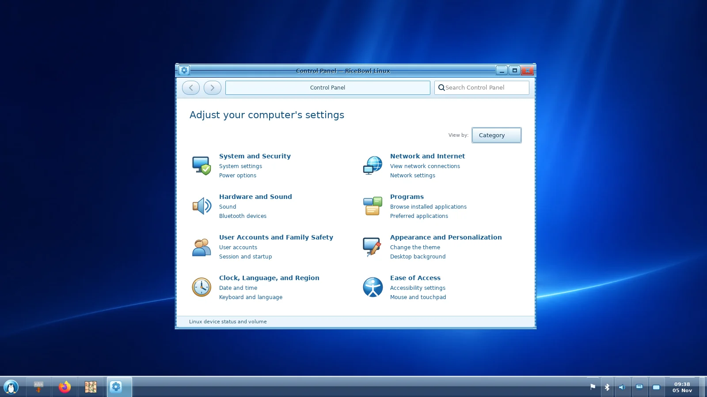
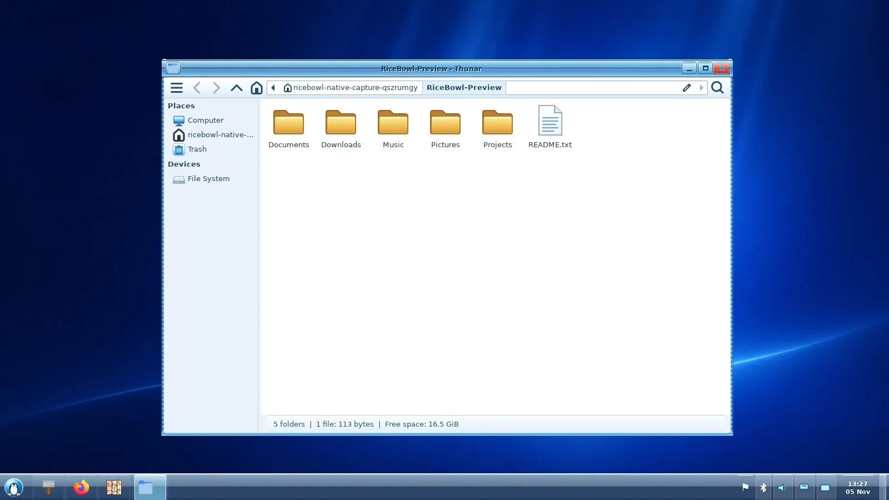

# Windows 7 · Aero Rice

This source tree contains the native GTK3/XFWM4 Windows 7 Aero experience. It uses
original RiceBowl Linux artwork, not Microsoft binaries, icons or wallpaper.

## Screenshots & coverage

These are real XFWM4/GTK3 desktop captures. Start and Control Panel come from
passing CI run [`41678284256`](https://github.com/CopyPasteUser/RiceBowl/actions/runs/41678284256);
the **new Explorer-style Thunar workspace** comes from passing native CI run
[`41686544328`](https://github.com/CopyPasteUser/RiceBowl/actions/runs/41686544328).
The pipeline also checks **1024×768** Start/Control Panel and Thunar placement. Owner Mint
hardware verification is separate.

### Desktop and taskbar


### Start menu

The Start menu lists real installed apps, grouped recent/favorites, searchable
All Programs and actual XDG folders. `Super_L` opens it with the search field
focused; `Escape` dismisses it.

### Control Panel

The Control Panel is now a genuine decorated, resizable Windows 7-style window,
opened from Start or `Control_R` rather than an Android-style tile popup. Its
eight historical categories have browseable task and applet pages, working
category/task search, **Back/Forward** history and Category/Large icons/Small
icons views. Only installed Linux utilities can launch; missing utilities
have explicit disabled actions and installation guidance. Hardware/network/
volume status remains in an expandable Linux section.

Five separate **Aero notification flyouts** open above their Superbar icons:
upright volume/mute and output devices, NetworkManager Wi-Fi discovery and
connections, battery/backlight/power profiles, BlueZ Bluetooth status, and a
real calendar. These use the existing bounded Linux backends and verify state
changes; they are independently styled for Windows 7, not XP repaints.
The screenshot below predates these flyouts and deeper navigation; new X11
captures and physical Mint verification remain open.



### Grouped taskbar, previews, Jump Lists and Peek

- Wnck groups windows by their actual X11 WM_CLASS; no synthetic grouping of unidentified windows.
- Hover a running application icon for a GTK preview popover. It captures a
  bounded X11 drawable when possible, otherwise displays the actual window icon.
  Windows hidden behind others may not yield a usable thumbnail.
- Click a grouped app to select its window; right-click to switch/close a
  specific window or pin a recognized installed application.
- Right-click pinned programs to open real MIME-compatible local recent files
  through that program. Empty Jump Lists never invent entries.
- Hover **Show Desktop** to temporarily reveal the desktop; moving away restores
  the previous state, while clicking commits the Show Desktop action.

The CI suite also verifies both 1600×900 and 1024×768. Native window tracking,
real notifications, multiple monitors, and power/network hardware need the
owner's Linux Mint XFCE acceptance; CI captures are not a physical desktop photo.

## What is included

| Desktop area | Implementation | Details |
| --- | --- | --- |
| **Start orb** | [Aero Penguin](assets/aero-penguin.svg) | Original branded Linux Start button; toggles a real GTK window |
| **Start menu** | [aero_shell.py](macrice/aero_shell.py) | Installed desktop programs, search, Enter/Escape/Down keyboard operation, paging, Home/Computer/Documents, Control Panel, safe XFCE session dialog |
| **Taskbar** | [aero_shell.py](macrice/aero_shell.py) / [aero_superbar.py](macrice/aero_superbar.py) | 48px glass Superbar, larger real app icons, WM_CLASS grouping, window previews, Jump Lists, minimize/restore, active group, overflow |
| **Control Panel** | [win7_control_panel.py](macrice/win7_control_panel.py) | Eight categories, three views, Back/Forward, applet details, installed Linux actions and unavailable states |
| **Pinned applications** | [aero_pins.py](macrice/aero_pins.py) | Right-click a Start result to pin, right-click taskbar icon to unpin; 6 persistent launchers maximum |
| **Show Desktop** | [aero_windows.py](macrice/aero_windows.py) | Wnck Show Desktop with safe reversible hover Peek and click action |
| **Notification area** | [win7_tray.py](macrice/win7_tray.py) / [aero_tray.py](macrice/aero_tray.py) | Five native Aero flyouts; SNI chevron hides excess application icons while prioritizing attention and exposing an accessible activation menu |
| **Desktop icons** | [win7_desktop.py](macrice/win7_desktop.py) | Explicit, reversible XFDesktop shortcuts for Computer, Documents, Network and Recycle Bin; user files and edited entries remain untouched |
| **Clock / quick links** | [aero_shell.py](macrice/aero_shell.py) | Clickable date/calendar and live volume, Wi-Fi, Bluetooth and battery buttons |
| **Glass** | [Aero shell CSS](macrice/aero_shell.py) | Glass-inspired gradient, optional translucent variant; no compositor blur guarantee |
| **Window decoration** | [XFWM4 theme](assets/themes/RiceHub-Aero/xfwm4/) | Real minimize, maximize, close, shading, sticky, border and title button artwork |
| **GTK widgets** | [GTK3 theme](assets/themes/RiceHub-Aero/gtk-3.0/gtk.css) | Unified buttons, menus, controls and palettes |
| **Application / places icons** | [RiceHub-Aero icon theme](assets/icons/RiceHub-Aero/) | Original golden folders (desktop, videos, templates, sharing), drive/network icons and eight distinct SVG MIME-type icons |
| **File manager** | [Thunar integration](macrice/thunar.py) / [RiceExplorer](https://github.com/CopyPasteUser/riceExplorer) | Safe default Thunar; optional Rust `--theme win7` preview from Start without association changes |
| **Dock** | [Aero glass Plank theme](assets/plank-themes/RiceHub-Aero-Glass/dock.theme) | Existing Plank configuration shifted away from the bottom taskbar during Aero apply |
| **Wallpapers** | [Seven Blue](assets/wallpapers/aero-seven-blue.jpg) / [Seven Night](assets/wallpapers/aero-seven-night.jpg) | Two original cobalt-blue 2009 Aero Linux-penguin desktops, distinct from Frutiger Aero |
| **Session startup** | [aero.py](macrice/aero.py) | RiceBowl-managed, user-local XFCE autostart; no global systemd service |
| **Backup and restore** | [rice.py](macrice/rice.py) | Explicit preflight, snapshot, apply, restore, preservation of later user edits where possible |
| **Hub gallery** | [hub.py](macrice/hub.py) | Select either Aero palette; check requirements before applying |
| **Concept preview** | [windows7_proto.py](macrice/windows7_proto.py) | Separate non-installing visual prototype, distinct from the real shell |
| **Small-screen geometry** | [aero_layout.py](macrice/aero_layout.py) | Bounded Start menu, task overflow and conservative EWMH bottom workarea reservation |

## Install, activate, revert

Supported target: Linux Mint XFCE running an **X11** session. Optional Wnck is required for active-window buttons and Show Desktop.

```bash
sudo apt install python3-gi gir1.2-gtk-3.0 gir1.2-wnck-3.0 librsvg2-common
git clone https://github.com/CopyPasteUser/RiceBowl.git
cd RiceBowl
bash install.sh --dry-run
bash install.sh                   # Never sudo for RiceBowl itself
macrice rice plan aero-meadow    # Read-only preflight
macrice rice apply aero-meadow   # Explicit change + backup
macrice rice apply aero-cascade  # Alternative palette
macrice rice restore             # Restore previous rice snapshot
```

Use `macrice aero-shell` to open/toggle Start and `macrice aero-shell --quit` to stop the resident shell. The ordinary installer does **not** activate Aero, replace XFCE Panel or alter your wallpaper.

### Thunar / Explorer refinement



Seven hides the native Thunar menu bar, while other rice families restore its
visibility. The genuine pathbar, native navigation buttons, search, shortcuts
pane, file operations and keyboard accessibility remain intact. On Thunar 4.20
the hidden menu is available through its automatic toolbar menu button; for
earlier versions use `Ctrl+M` or reapply another rice. Manual recovery:

```bash
xfconf-query -c thunar -p /last-menubar-visible -s true
thunar -q
```

GTK CSS does not expose Windows 7's Libraries namespace, metadata preview
pane or contextual `Organize / New folder` command strip. Those would need a
separate file-manager frontend or a substantial Thunar extension; RiceBowl
does not add fake, nonfunctional buttons. With RiceExplorer installed, the
Start menu additionally shows **RiceExplorer (preview)**, opening the real
Rust Windows 7 renderer at the home directory. It does not replace Thunar or
promise currently unsupported remote mounts and complete transfer recovery.

### Customization and compatibility

- **Notification chevron:** By default, at most three active application SNI icons appear
  directly beside the clock/system icons. The upward arrow opens the remaining
  entries; those marked `NeedsAttention` take priority. Right-click the hidden
  entry to request its application's context menu. Choose **Customize notification
  icons…** from that menu or a blank Superbar right-click to set the visible
  limit (0–8), and each application's Automatic / Show / Hide preference.
  Applications without stable protocol IDs remain automatic. Settings are saved
  at `${XDG_CONFIG_HOME:-~/.config}/ricehub/win7-tray.json`; **Restore defaults**
  returns to three directly visible icons. This only affects Aero.
- **Real desktop links:** Right-click a *blank section* of the Windows 7
  Superbar to add or remove RiceBowl's Computer, Documents, Network and
  Recycle Bin shortcuts. The action asks permission, uses XFDesktop's actual
  desktop directory, and preserves existing or user-edited files. The same
  menu opens real desktop personalization if `xfdesktop-settings` exists.
- **Taskbar pins:** Right-click a program in the Start search results to **Pin to taskbar**; right-click its taskbar icon to **Unpin**. The list is stored atomically in `${XDG_CONFIG_HOME:-~/.config}/ricehub/aero-pins.json`. No shell commands are read from this file; only validated desktop IDs.
- **Translucent look:** Relaunch with `RICEHUB_AERO_GLASS=1 macrice aero-shell`. This is translucent styling, **not** true wallpaper blur. A compositor and RGBA support determine its appearance.
- **Tray opt-out:** Use `RICEHUB_AERO_TRAY=0 macrice aero-shell` if another tray implementation conflicts.
- **Workarea opt-out:** Use `RICEHUB_AERO_RESERVE=0 macrice aero-shell` if you deliberately keep another bottom dock/panel. Otherwise, Aero reserves the root bottom edge through standard X11 EWMH hints where geometry permits.
- **Persistent environment overrides:** Set them in your session environment before XFCE autostart; invoking an existing process with a new environment does not alter that process.
- **System actions:** Control Panel and Log off launch existing XFCE dialogs. There is no immediate shutdown, no shell execution of untrusted text, and no automatic package installation.
- **Dependencies:** Optional SNI and Wnck are degraded gracefully if absent. Legacy XEmbed tray icons are **not** implemented.
- **Coexistence:** RiceBowl never force-kills an existing XFCE Panel or MacBar when applying a rice; disable redundant panels yourself only after checking recovery.

## Visual assets — every bundled Aero element

### Desktop backgrounds and identity

- [assets/aero-penguin.svg](assets/aero-penguin.svg)
- [assets/wallpapers/aero-seven-blue.jpg](assets/wallpapers/aero-seven-blue.jpg)
- [assets/wallpapers/aero-seven-night.jpg](assets/wallpapers/aero-seven-night.jpg)

### GTK theme

- [gtk.css](assets/themes/RiceHub-Aero/gtk-3.0/gtk.css)

### Window decorations (all XFWM4 states)

- [bottom-active.png](assets/themes/RiceHub-Aero/xfwm4/bottom-active.png)
- [bottom-inactive.png](assets/themes/RiceHub-Aero/xfwm4/bottom-inactive.png)
- [bottom-left-active.png](assets/themes/RiceHub-Aero/xfwm4/bottom-left-active.png)
- [bottom-left-inactive.png](assets/themes/RiceHub-Aero/xfwm4/bottom-left-inactive.png)
- [bottom-right-active.png](assets/themes/RiceHub-Aero/xfwm4/bottom-right-active.png)
- [bottom-right-inactive.png](assets/themes/RiceHub-Aero/xfwm4/bottom-right-inactive.png)
- [close-active.png](assets/themes/RiceHub-Aero/xfwm4/close-active.png)
- [close-inactive.png](assets/themes/RiceHub-Aero/xfwm4/close-inactive.png)
- [close-prelight.png](assets/themes/RiceHub-Aero/xfwm4/close-prelight.png)
- [close-pressed.png](assets/themes/RiceHub-Aero/xfwm4/close-pressed.png)
- [hide-active.png](assets/themes/RiceHub-Aero/xfwm4/hide-active.png)
- [hide-inactive.png](assets/themes/RiceHub-Aero/xfwm4/hide-inactive.png)
- [hide-prelight.png](assets/themes/RiceHub-Aero/xfwm4/hide-prelight.png)
- [hide-pressed.png](assets/themes/RiceHub-Aero/xfwm4/hide-pressed.png)
- [left-active.png](assets/themes/RiceHub-Aero/xfwm4/left-active.png)
- [left-inactive.png](assets/themes/RiceHub-Aero/xfwm4/left-inactive.png)
- [maximize-active.png](assets/themes/RiceHub-Aero/xfwm4/maximize-active.png)
- [maximize-inactive.png](assets/themes/RiceHub-Aero/xfwm4/maximize-inactive.png)
- [maximize-prelight.png](assets/themes/RiceHub-Aero/xfwm4/maximize-prelight.png)
- [maximize-pressed.png](assets/themes/RiceHub-Aero/xfwm4/maximize-pressed.png)
- [menu-active.png](assets/themes/RiceHub-Aero/xfwm4/menu-active.png)
- [menu-inactive.png](assets/themes/RiceHub-Aero/xfwm4/menu-inactive.png)
- [menu-prelight.png](assets/themes/RiceHub-Aero/xfwm4/menu-prelight.png)
- [menu-pressed.png](assets/themes/RiceHub-Aero/xfwm4/menu-pressed.png)
- [right-active.png](assets/themes/RiceHub-Aero/xfwm4/right-active.png)
- [right-inactive.png](assets/themes/RiceHub-Aero/xfwm4/right-inactive.png)
- [shade-active.png](assets/themes/RiceHub-Aero/xfwm4/shade-active.png)
- [shade-inactive.png](assets/themes/RiceHub-Aero/xfwm4/shade-inactive.png)
- [shade-prelight.png](assets/themes/RiceHub-Aero/xfwm4/shade-prelight.png)
- [shade-pressed.png](assets/themes/RiceHub-Aero/xfwm4/shade-pressed.png)
- [stick-active.png](assets/themes/RiceHub-Aero/xfwm4/stick-active.png)
- [stick-inactive.png](assets/themes/RiceHub-Aero/xfwm4/stick-inactive.png)
- [stick-prelight.png](assets/themes/RiceHub-Aero/xfwm4/stick-prelight.png)
- [stick-pressed.png](assets/themes/RiceHub-Aero/xfwm4/stick-pressed.png)
- [themerc](assets/themes/RiceHub-Aero/xfwm4/themerc)
- [title-1-active.png](assets/themes/RiceHub-Aero/xfwm4/title-1-active.png)
- [title-1-inactive.png](assets/themes/RiceHub-Aero/xfwm4/title-1-inactive.png)
- [title-2-active.png](assets/themes/RiceHub-Aero/xfwm4/title-2-active.png)
- [title-2-inactive.png](assets/themes/RiceHub-Aero/xfwm4/title-2-inactive.png)
- [title-3-active.png](assets/themes/RiceHub-Aero/xfwm4/title-3-active.png)
- [title-3-inactive.png](assets/themes/RiceHub-Aero/xfwm4/title-3-inactive.png)
- [title-4-active.png](assets/themes/RiceHub-Aero/xfwm4/title-4-active.png)
- [title-4-inactive.png](assets/themes/RiceHub-Aero/xfwm4/title-4-inactive.png)
- [title-5-active.png](assets/themes/RiceHub-Aero/xfwm4/title-5-active.png)
- [title-5-inactive.png](assets/themes/RiceHub-Aero/xfwm4/title-5-inactive.png)
- [top-left-active.png](assets/themes/RiceHub-Aero/xfwm4/top-left-active.png)
- [top-left-inactive.png](assets/themes/RiceHub-Aero/xfwm4/top-left-inactive.png)
- [top-right-active.png](assets/themes/RiceHub-Aero/xfwm4/top-right-active.png)
- [top-right-inactive.png](assets/themes/RiceHub-Aero/xfwm4/top-right-inactive.png)

### Application icons

- [accessories-calculator.svg](assets/icons/RiceHub-Aero/scalable/apps/accessories-calculator.svg)
- [accessories-text-editor.svg](assets/icons/RiceHub-Aero/scalable/apps/accessories-text-editor.svg)
- [applications-other.svg](assets/icons/RiceHub-Aero/scalable/apps/applications-other.svg)
- [preferences-system.svg](assets/icons/RiceHub-Aero/scalable/apps/preferences-system.svg)
- [ricehub-aero.svg](assets/icons/RiceHub-Aero/scalable/apps/ricehub-aero.svg)
- [start-here.svg](assets/icons/RiceHub-Aero/scalable/apps/start-here.svg)
- [system-file-manager.svg](assets/icons/RiceHub-Aero/scalable/apps/system-file-manager.svg)
- [utilities-terminal.svg](assets/icons/RiceHub-Aero/scalable/apps/utilities-terminal.svg)
- [web-browser.svg](assets/icons/RiceHub-Aero/scalable/apps/web-browser.svg)
- [xfce4-menu.svg](assets/icons/RiceHub-Aero/scalable/apps/xfce4-menu.svg)

### Places and desktop icons

- [computer.svg](assets/icons/RiceHub-Aero/scalable/places/computer.svg)
- [folder.svg](assets/icons/RiceHub-Aero/scalable/places/folder.svg)
- [user-home.svg](assets/icons/RiceHub-Aero/scalable/places/user-home.svg)
- [user-trash.svg](assets/icons/RiceHub-Aero/scalable/places/user-trash.svg)

### Icon theme metadata and glass dock

- [assets/icons/RiceHub-Aero/index.theme](assets/icons/RiceHub-Aero/index.theme)
- [assets/plank-themes/RiceHub-Aero-Glass/dock.theme](assets/plank-themes/RiceHub-Aero-Glass/dock.theme)
- [assets/themes/RiceHub-Aero/index.theme](assets/themes/RiceHub-Aero/index.theme)

## Architecture and automated verification

The real Aero shell is deliberately independent of the older visual prototype:

- [Shell](macrice/aero_shell.py), [window tracker](macrice/aero_windows.py), [SNI tray](macrice/aero_tray.py), [layout](macrice/aero_layout.py) and [pin preferences](macrice/aero_pins.py)
- [Theme preflight / autostart](macrice/aero.py) and [rice snapshot/restore](macrice/rice.py)
- [Aero tests](tests/test_aero.py), [Wnck tests](tests/test_aero_windows.py), [SNI tests](tests/test_aero_tray.py), [layout tests](tests/test_aero_layout.py), [pin tests](tests/test_aero_pins.py)
- [GitHub CI](.github/workflows/ci.yml) now includes a real GTK/X11 Start menu smoke run using Xvfb and a session D-Bus.

### Manual release acceptance on physical Linux Mint XFCE

- [ ] Fresh clone and user-local install; normal XFCE remains untouched until explicit Apply
- [ ] Both Aero styles: wallpaper, icons, GTK and XFWM borders, Thunar and Plank appearance
- [ ] Start menu: all programs, search, keyboard focus, escape, open/close/open cycles
- [ ] Pin/unpin apps, log out and log in; confirmed persistent pins
- [ ] Wnck: 1, 3 and 10 windows, focus, minimize, restore, overflow and Show Desktop
- [ ] SNI icons with two real applications, right-click menus, watcher takeover, third-party watcher coexistence
- [ ] Widescreen, 1366×768, low resolution, HiDPI, second monitor, session restart
- [ ] XFCE Panel coexistence, maximized windows and the optional workarea reservation
- [ ] Recovery after failed apply, latest-settings conflict and session restart
- [ ] PSS/CPU readings and screenshots of optional Wnck/SNI/Plank integrations on target hardware

**Release classification:** feature-rich Windows 7 Aero rice candidate, *not yet a physically signed-off stable 1.0*. Current core-shell screenshots are available, but real-machine acceptance and optional-integration screenshots remain open. No Win32 API emulation, Aero Peek/jump lists, legacy XEmbed, true blur, or Windows-specific software compatibility is claimed.
