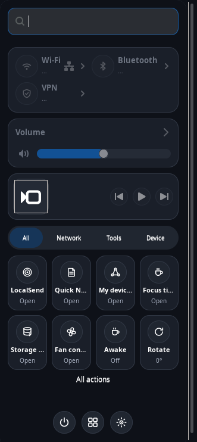
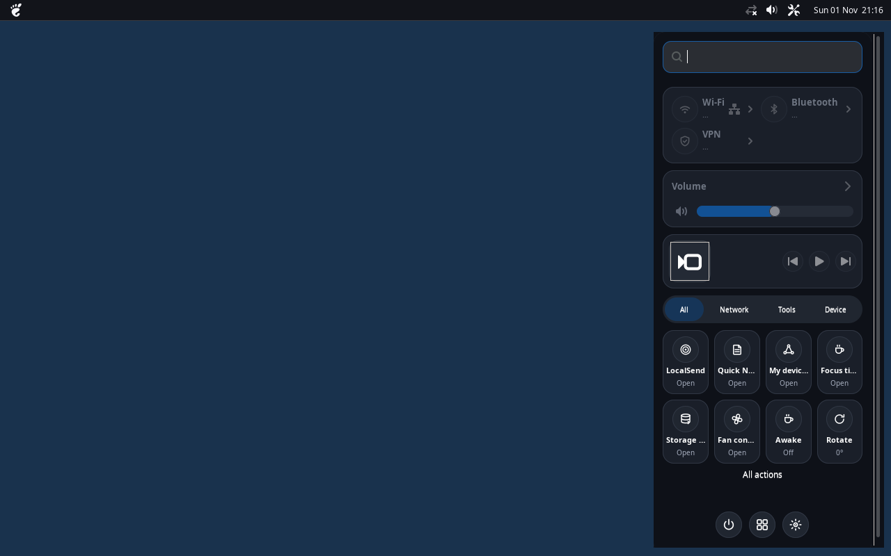

# macOS Control Center for XFCE

A small piece of macOS inspiration for a desktop that is still unmistakably Linux.

I built this because I wanted quick access to Wi-Fi, audio, Bluetooth and the tools I actually use, without opening a different settings window every time. It is a standalone GTK3 popup for XFCE/X11, not a replacement desktop environment or an XFCE panel plugin.



*The real GTK window, captured on an isolated X11 display. Hardware-dependent values may be unavailable in this test environment.*

<details>
<summary>See it alongside MacBar</summary>



*Actual GTK rendering; the plain background is a temporary test desktop, not a macOS wallpaper.*

</details>

## What it does

- **Connections:** Wi-Fi, Bluetooth, VPN and available network details.
- **Sound and display:** volume, mute, output devices, brightness and supported media-player controls.
- **Quick actions:** configurable shortcuts, search, categories and a compact eight-action view.
- **Useful extras:** quick notes, storage analysis, hardware sensors, Wake-on-LAN devices and a focus timer.
- **Personalization:** Midnight, Graphite, Frosted and Light themes; accent colors, language and reduced motion.
- **Resource control:** Light, Balanced, Responsive and Custom polling profiles; background refresh pauses while the popup is hidden.

Optional controls depend on your hardware and installed system tools. The app does not need root privileges for installation.

## Install or update

Designed for Linux Mint XFCE and other X11 desktops with Python 3 and GTK3/PyGObject.

```bash
sudo apt install python3-gi gir1.2-gtk-3.0
git clone https://github.com/CopyPasteUser/xfce-macos-control-center.git
cd xfce-macos-control-center
bash install.sh
```

Already installed? Pull the latest code and run `bash install.sh` again. The user-local installer backs up the previous program, replaces its verified resident process and **preserves your configuration, devices and notes**. No `sudo` for the installer.

Prefer to keep the popup closed after installing? Use `bash install.sh --start-hidden`. For package validation without starting GTK, use `bash install.sh --no-start`.

### Open, close, repeat

Bind this command under **XFCE Settings → Keyboard → Application Shortcuts**, or use it in MacBar:

```bash
~/.local/bin/macos-control-center-toggle
```

Press once to open, again to close, again to reopen. Version **2.1.1** sends warm toggles directly to the resident GTK window over session D-Bus, with atomic visibility changes on the UI thread. The previous PID/signal launcher remains as a cold-start and compatibility fallback. The app preloads hidden at login.

The warm D-Bus path removes repeated Python startup, process scans and state-file reads; it does **not** remove GTK's initial cold-start cost. An isolated headless round-trip check passed, but actual desktop frame latency depends on your computer.

## Where things live

| File or command | Location |
| --- | --- |
| Toggle launcher | `~/.local/bin/macos-control-center-toggle` |
| Installed program | `~/.local/share/macos-control-center/app/` |
| Preferences and private notes | `~/.config/macos-control-center/` |
| Diagnostics | `~/.local/share/macos-control-center/doctor.sh` |
| Previous code and logs | `~/.local/share/macos-control-center/backups/` and `logs/` |

For a clean removal while keeping your personal configuration, use `bash uninstall.sh`.

## Development and limitations

```bash
PATH=/usr/bin:/bin bash run-tests.sh
/usr/bin/python3 -m unittest tests/test_fast_toggle.py tests/test_dbus_roundtrip.py -v
```

The second command uses a temporary session bus for the D-Bus integration check. The GTK source, installer, hardware fallbacks and update tests have been exercised, but a real XFCE multi-monitor and suspend/resume test is still needed.

This is primarily an **X11** application. Wayland compositor behavior varies; network, Bluetooth, brightness and audio controls require compatible system services and permissions. LocalSend is deliberately denied access to all mounts under `/mnt` by default.

For technical details, see [the validation guide](docs/VALIDATION.md) and [changelog](CHANGELOG.md). For a companion app launcher and top bar, see [MacMenu](https://github.com/CopyPasteUser/xfce-macmenu) and [MacBar](https://github.com/CopyPasteUser/xfce-macbar).

*Built for a calmer XFCE desktop: fewer windows to open, fewer things to think about.*
