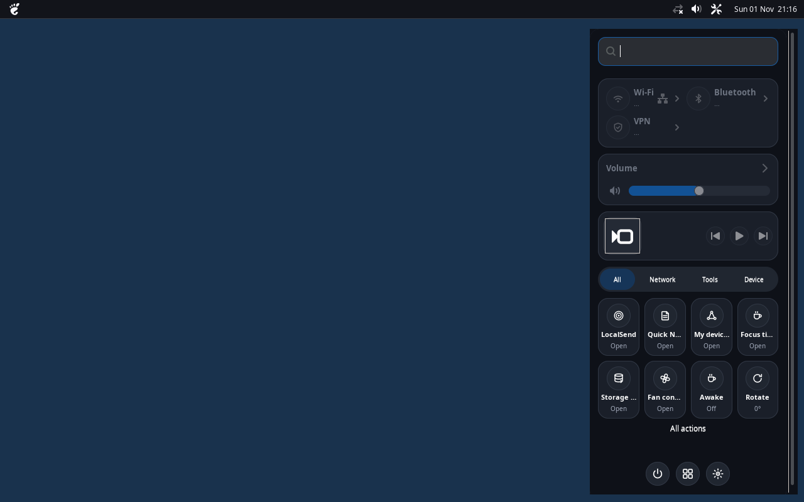

# MacBar for XFCE

The top bar I wanted for my macOS-inspired Linux desktop: just the essentials, built with GTK3 and Python. MacMenu launches apps, Control Center handles settings, and Plank handles running windows. MacBar stays out of the way.


*Real GTK screenshot at 1280px width. Status icons may show fallback values without NetworkManager or a real battery.*

<details>
<summary>See MacBar with Control Center</summary>



*Both apps running on an isolated X11 test desktop.*

</details>

## The essentials

- **Left:** a launcher for [MacMenu](https://github.com/CopyPasteUser/xfce-macmenu). No app title, menu bar or task list.
- **Right:** network type, sound, battery when available, a Control Center launcher and the local clock.
- **Deliberately simple:** no dropdowns, duplicate sliders or screen-edge tooltip problems.
- **Native and light:** GTK3/X11, a single Python process, event-driven network updates and infrequent status reads.
- **Desktop-friendly:** top-edge reservation, dark/light styling, primary-monitor changes and a 30px default height.

This is **v1.0.0**. Being smaller than XFCE Panel is a goal, not a verified RAM benchmark. `measure.py` helps compare proportional memory (PSS) on your own system.

## Install

You need an XFCE/X11 desktop and system Python with GTK3/PyGObject:

```bash
sudo apt install python3-gi gir1.2-gtk-3.0
git clone https://github.com/CopyPasteUser/xfce-macbar.git
cd xfce-macbar
bash install.sh
~/.local/bin/macbar
```

The installer uses user-local paths and **does not disable XFCE Panel or Plank** by default. Try it alongside your current panel first.

The defaults call `macmenu --toggle` and `macos-control-center --toggle`. With Control Center 2.1.1 installed, its launcher uses the fast D-Bus toggle automatically.

To customize the theme, panel height or launcher commands, edit `~/.config/macbar/config.json` and restart MacBar. See [the example configuration](config.example.json).

### Enable on login

After testing the launchers and icons:

```bash
bash install.sh --autostart --replace-xfce
```

This adds MacBar to autostart and asks the existing XFCE Panel to quit **after MacBar has mapped**. It does not delete XFCE's configuration.

To restore XFCE Panel:

```bash
mv ~/.config/autostart/macbar.desktop ~/.config/macbar/backup/macbar-autostart.disabled
xfce4-panel
```

If XFCE Panel keeps respawning, disable its session restart under **Session and Startup → Current Session**. Do not uninstall XFCE Panel just to try MacBar.

## Limits and checks

MacBar intentionally has **no generic third-party system tray** or global File/Edit menus. Keep the original panel available if an app relies on tray icons. Wayland is not supported; some exotic multi-monitor arrangements cannot reserve the top edge reliably.

```bash
/usr/bin/python3 -m unittest discover -s tests -v
/usr/bin/python3 measure.py
```

Automated tests cover layout, status and installation. The screenshots were rendered in a headless X11 session; real-world suspend/resume, network indicators and RAM comparisons still need validation on your machine.

[Roadmap](ROADMAP.md) · [Changelog](CHANGELOG.md) · [MIT license](LICENSE)

*One clean bar, three apps doing their own jobs.*
