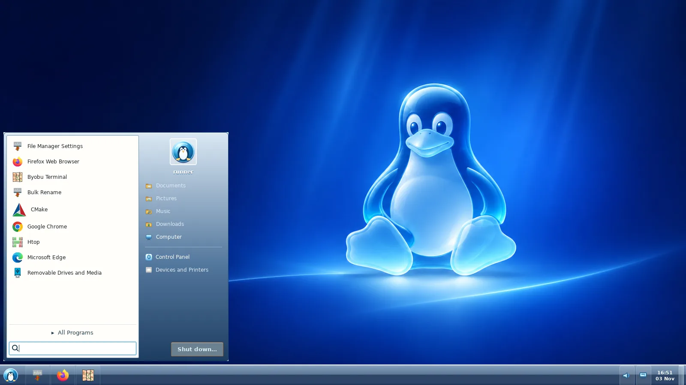
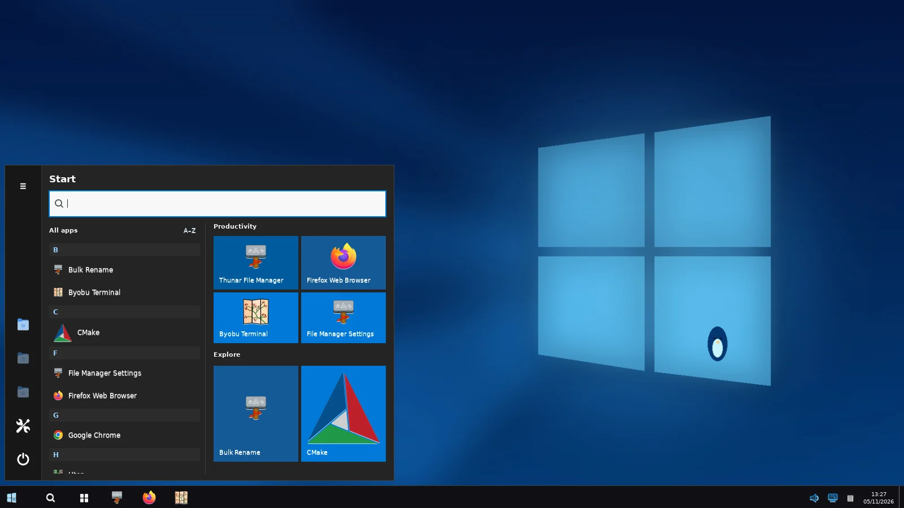
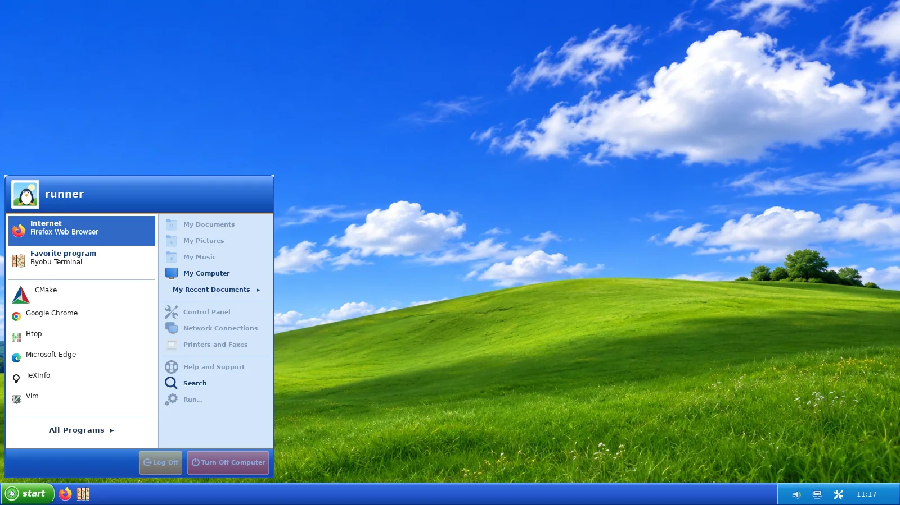
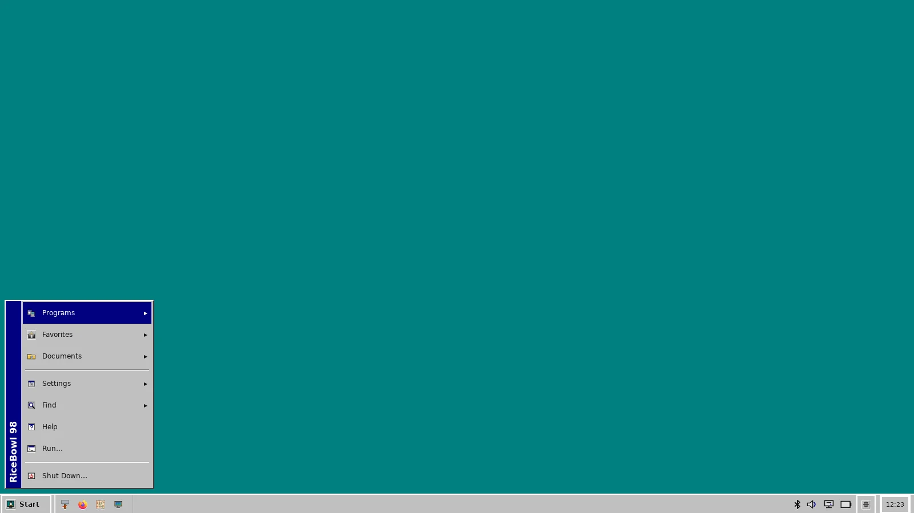
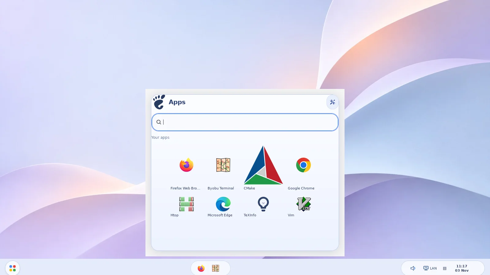
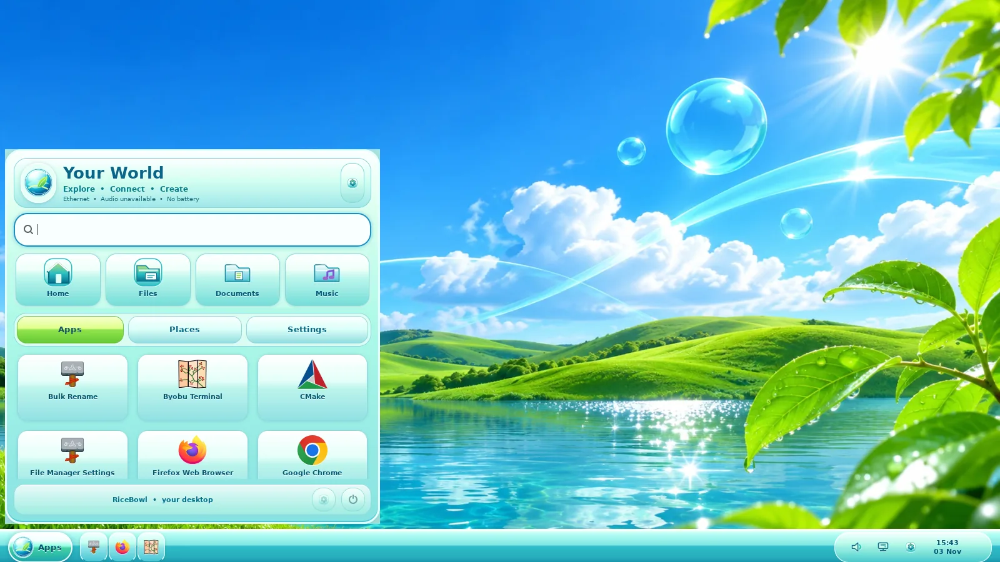
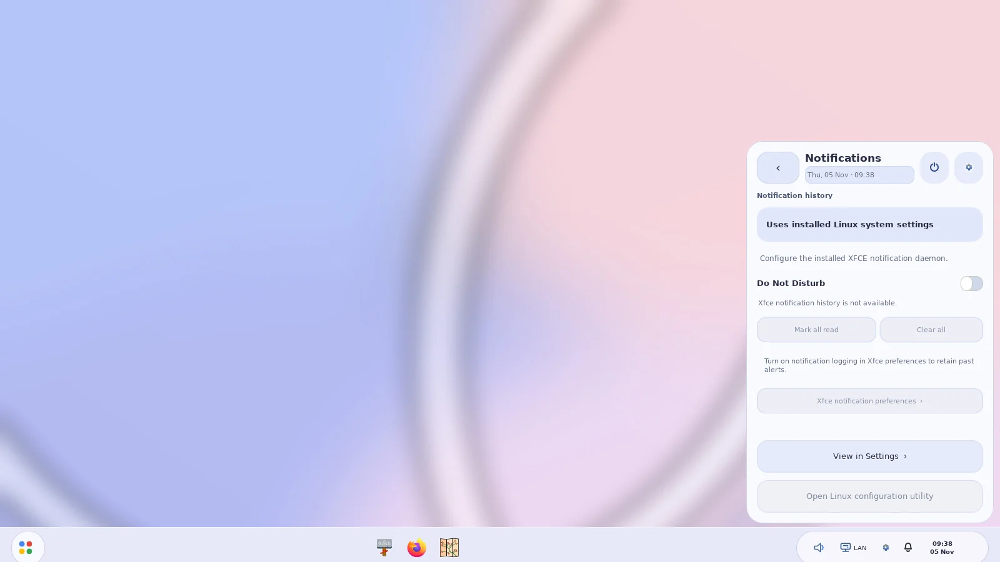
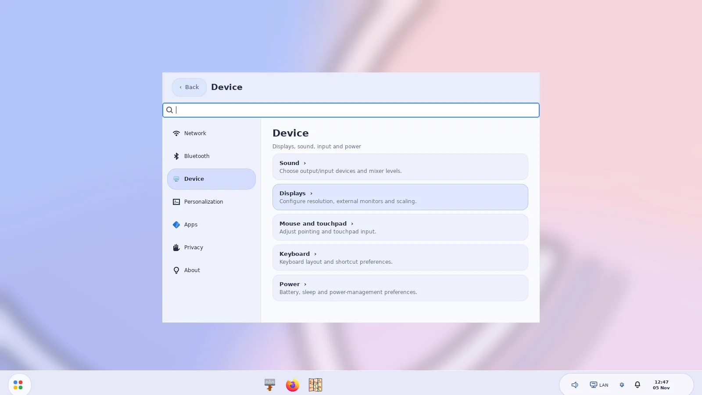
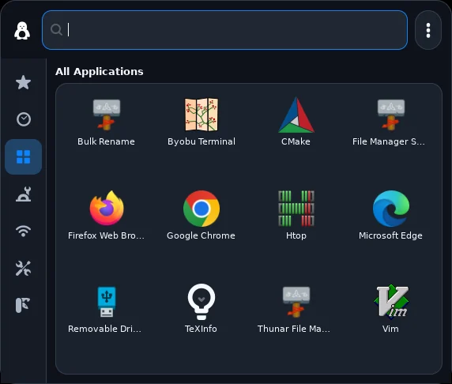

# Current RiceBowl screenshots

All **32 images** in this gallery are WebP conversions of genuine, running
GTK3 applications on virtual X11—not designs or simulated operating-system
screenshots. The wallpaper, taskbars, menus, device-state fallbacks and visible
application windows were rendered by the tested RiceBowl code.

**Single-run provenance (4 November 2026):**

- [Passing GitHub Actions capture run **41804502628**](https://github.com/CopyPasteUser/RiceBowl/actions/runs/41804502628)
- Exact tested source commit: [`f95c847c3f1b7faeb6f8241ed173b0e0c569b6ab`](https://github.com/CopyPasteUser/RiceBowl/commit/f95c847c3f1b7faeb6f8241ed173b0e0c569b6ab)
- Authentic **1600×900** XFWM4/GTK/Thunar screenshots for six non-macOS rices;
  the CI artifact also retains genuine **1024×768** compact-layout captures.
- [Machine-readable manifest with original PNG and WebP SHA-256 hashes](manifest.json)

The historical `0.9.1` portion of the CI PNG filenames is a capture-script
compatibility name; **the content comes from the exact source revision above**,
not the older tagged 0.9.1 release.

## Six desktop styles

| Style | Start / Launcher | More genuine windows |
| --- | --- | --- |
| **Windows 7 Aero** |  | [Control Panel](aero-controls.webp) · [Thunar + XFWM4](aero-workspace.webp) |
| **Windows 10** |  | [Action Center](windows10-controls.webp) · [Thunar + XFWM4](windows10-workspace.webp) |
| **Windows XP Luna** |  | [Control Panel](winxp-controls.webp) · [Thunar + XFWM4](winxp-workspace.webp) |
| **Windows 98 Classic** |  | [Control Panel](winclassic-controls.webp) · [Thunar + XFWM4](winclassic-workspace.webp) |
| **ChromeOS** |  | [Quick Settings](chromeos-controls.webp) · [Thunar + XFWM4](chromeos-workspace.webp) |
| **Frutiger Aero** |  | [Quick Settings](frutiger-controls.webp) · [Thunar + XFWM4](frutiger-workspace.webp) |

## Deeper interactions captured in the same run

### ChromeOS

| Real notification-history fallback | Native Settings: Device |
| --- | --- |
|  |  |

The capture environment has no installed XFCE notification-history daemon;
RiceBowl accurately displays its **unavailable** state instead of inventing
notifications, unread counts or Do Not Disturb support.

### XP Luna

| Start navigation | Control Panel and session dialogs |
| --- | --- |
| [All Programs](winxp-programs.webp) · [Control Panel detail](winxp-detail.webp) · [Classic view](winxp-classic.webp) | [Taskbar Properties](winxp-properties.webp) · [Notification icons](winxp-notification-icons.webp) · [Run…](winxp-run.webp) |

All five XP tray controls are also captured: [Audio](winxp-tray-audio.webp) ·
[Network](winxp-tray-network.webp) · [Battery](winxp-tray-battery.webp) ·
[Bluetooth](winxp-tray-bluetooth.webp) · [Clock](winxp-tray-clock.webp).
These captures record the actual capabilities or unavailable fallbacks of the
CI fixture; they are not proof that the owner's hardware exposes every service.

### macOS component

This is a **real standalone MacMenu GTK window** captured in the same CI run.
It is *not* a fully integrated macOS desktop. A current composite of MacBar,
Control Center, dock/Plank and actual file window is still outstanding; older
component-specific release screenshots are kept in their historical locations
and are not misrepresented as current captures.

## Capture scope

The `workspace` screenshots show a **real Thunar process under XFWM4**, with
the GTK/icon theme and Thunar preferences RiceBowl applies. Each process opens
a disposable fixture folder containing sample files; user files and desktop
settings are not touched. The screenshot importer checks all 32 images and
their size, resolution, distinctness and control-window presence before
replacing the gallery, then records their hashes in the manifest.

These images validate a disposable CI desktop, **not physical Linux Mint
hardware acceptance**, multi-monitor behavior, Bluetooth hardware or
login/suspend recovery. The original full-resolution PNGs and compact-layout
captures can be retrieved from the linked CI run artifact.
